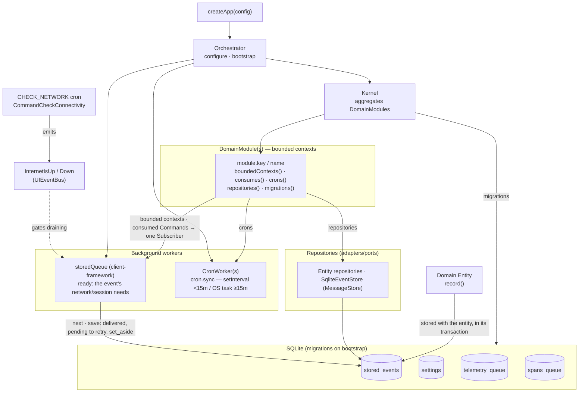
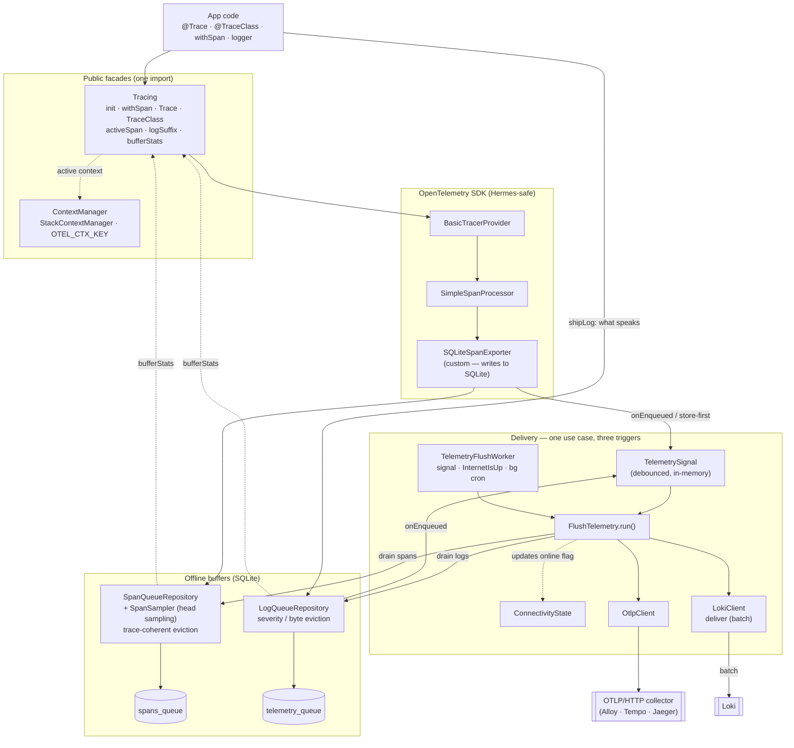

# @sincpro/mobile

**Enterprise mobile application framework for React Native / Expo** — built on hexagonal architecture, domain-driven design, and offline-first infrastructure.

Enterprise mobile development has always been hard. Applications need to work without internet, recover from failures gracefully, sync data when connectivity returns, manage authentication state, handle background tasks, print documents, and do all of this across iOS and Android with a single codebase. Each project that solves these problems from scratch solves them differently — and then someone has to maintain those differences forever.

`@sincpro/mobile` is Sincpro's answer to that problem. This framework encodes proven enterprise patterns once — event queues, dead-letter queues, domain event sourcing, offline-first storage, cron workers, adapter ports — and every app built on it inherits those capabilities by default.

**Sincpro maintains this.** The source is open and anyone can read it. What Sincpro provides is the commitment behind it: stable contracts, long-term API support, updates as platforms evolve, and people accountable for the behaviors your business depends on. This is not a project that gets abandoned. It is infrastructure for the new era of enterprise mobile development, and Sincpro intends to maintain it for the teams and clients that build on top of it.

> **AI agent?** Read [`AGENTS.md`](AGENTS.md) first — ecosystem orientation, patterns, and traps. Known runtime issues live in [`docs/GOTCHAS.md`](docs/GOTCHAS.md).
>
> **Deep engineering docs** (component + sequence diagrams, design rationale) live in [`docs/`](docs/README.md): [core architecture](docs/architecture-core.md), [telemetry](docs/architecture-telemetry.md), and the [consumer app structure](docs/architecture-consumer.md). This README is the summary.

---

## ⚡ Quick Start

Here is the minimum to get a working enterprise app running:

```bash
npx expo install @sincpro/mobile @sincpro/mobile-ui
```

```tsx
// 1. Define your domain module
import { DomainModule } from "@sincpro/mobile/framework/domain_module";
import type { CronWorker } from "@sincpro/mobile/infrastructure/workers";

class SalesModule extends DomainModule {
  readonly key = "SALES";
  readonly name = "Sales";

  // @sincpro/client-framework: the bounded context — its use cases and its event handlers
  override boundedContexts() {
    return [salesBoundedContext];
  }
  override crons(): CronWorker[] {
    return SalesCronJobs;
  }
}

const salesModule = new SalesModule();

// 2. Define the shell at module scope, wrap the host's router with it
// app/_layout.tsx
import { AppShell, createTheme, defineAppShell } from "@sincpro/mobile";
import { Stack } from "expo-router";

const shell = defineAppShell({
  theme: createTheme({ accent: "#0EA5E9" }),
  domains: [salesModule],
});

export default function RootLayout() {
  return (
    <AppShell shell={shell}>
      <Stack screenOptions={{ headerShown: false }} />
    </AppShell>
  );
}
```

`defineAppShell` runs while the bundle loads: it applies the theme and fonts, holds the splash and defines background crons. `<AppShell>` runs database migrations, starts the event queue and crons, and mounts the host's router once the data layer is ready. The framework never mounts a navigator: routes belong to the host.

A use case's name is its class's, taken when it registers, so a production build keeps class names: the host's `metro.config.js` sets `transformer.minifierConfig = { keep_classnames: true }`.

---

## 📑 Table of Contents

1. [Why This Framework Exists](#why-this-framework-exists)
2. [Architecture Overview](#architecture-overview)
3. [Ecosystem](#ecosystem)
4. [Key Features](#key-features)
5. [Creating a DomainModule](#creating-a-domainmodule)
6. [AppShell Configuration](#appshell-configuration)
7. [Theme Configuration](#theme-configuration)
8. [Brand Font Configuration](#brand-font-configuration)
9. [Public API](#public-api)
10. [Telemetry Architecture](#telemetry-architecture)
11. [Subpaths](#subpaths)
12. [Development](#development)

---

## 🔍 Why This Framework Exists

### The Enterprise Mobile Problem

Building a business mobile application is not the same as building a consumer app. Business apps need to work in warehouses with no Wi-Fi. They need to print receipts to Bluetooth thermal printers. They need to sync order data when the connection comes back, in the right order, without duplicates. They need to run background jobs that don't drain the battery. They need authentication that safely clears sensitive data on logout. They need dark and light themes that match the brand manual. They need to ship fast and be maintained for years.

None of this is hard in isolation. All of it together, across iOS and Android, from scratch, for every project — is expensive, inconsistent, and difficult to maintain.

### The AI Era Problem

AI tools can generate code faster than ever. That makes the absence of a framework _more_ dangerous, not less. When there is no shared architecture, AI-generated code is consistent only with itself — each prompt produces a different pattern, a different naming convention, a different approach to the same problem. The velocity is real. The maintenance cost is also real.

With `@sincpro/mobile`, AI tools have clear patterns to follow: `DomainModule`, `defineAppShell`, `BoundedContext`, `Feature`, `CronWorker`, `Entity.record`. Code generated within the framework is framework-compliant by default. Human reviewers can audit it quickly. The codebase stays navigable.

### The Multi-Platform Bet

React Native and Expo are the right foundation for enterprise cross-platform mobile in 2025 and beyond. A single TypeScript codebase, native performance, the full JavaScript ecosystem, and Expo's managed platform for OTA updates and native modules. Sincpro commits to maintaining the enterprise layer on top of this foundation as it evolves — consumers get platform upgrades without rewriting their business logic.

### What Sincpro Provides

Open-source software is valuable. Maintained open-source software is rare. The difference is people: engineers who triage issues, update dependencies, handle platform breaking changes, document traps they found in production, and preserve behavioral contracts across major versions.

Sincpro builds and maintains `@sincpro/mobile` because we build and support the clients that run on it. When a behavior breaks, we fix it. When Expo upgrades their SDK, we absorb the migration. When a new enterprise pattern proves itself in production, we promote it into the framework so every app inherits it. That is the commitment.

---

## 🏗️ Architecture Overview

The framework is organized in strict layers with enforced one-way dependency flow:

```
┌─────────────────────────────────────────────────────┐
│              Business Apps                          │
│    sincpro-mobile-tickets / distribution / …        │
└────────────────────────┬────────────────────────────┘
                         │
┌────────────────────────▼────────────────────────────┐
│           @sincpro/mobile-odoo  (optional)          │
│         OdooClient · Auth · Partner sync            │
└────────────────────────┬────────────────────────────┘
                         │
┌────────────────────────▼────────────────────────────┐
│              @sincpro/mobile  ◄── YOU ARE HERE       │
│                                                     │
│  framework/      DomainModule · Kernel · Orchestrator│
│  domain/         Entity · Event Sourcing · Ports    │
│  infrastructure/ stored queue · CronWorker · SQLite │
│  adapters/       Network · Bluetooth · Geo · WebView│
│  services/       Printer · Events · Network        │
│  entrypoints/    AppShell · DB · Queue · Cron       │
└────────────────────────┬────────────────────────────┘
                         │
┌────────────────────────▼────────────────────────────┐
│              @sincpro/mobile-ui                     │
│         Design System — no domain knowledge         │
└─────────────────────────────────────────────────────┘
```

### Key Architectural Principles

- **Hexagonal Architecture (Ports and Adapters).** The domain layer defines interfaces (`IPrinterDriver`, `IRepository`). Concrete implementations live outside and are injected. The core never imports hardware SDKs.
- **Domain-Driven Design.** Each bounded context is a `DomainModule`. The framework orchestrates them; they never know about each other.
- **Offline-First.** Every domain event is stored in SQLite before it is delivered (`storedQueue` of `@sincpro/client-framework`). Events survive app restarts and are delivered on recovery.
- **Strict layer boundaries.** A lower layer cannot import from a higher one. `mobile-ui` has no imports from `@sincpro/mobile`.

### Base infrastructure — events, queues, repositories, orchestrator

`createApp` configures the **Orchestrator**, which bootstraps the **Kernel** (the set of `DomainModule`s). Each module contributes bounded contexts (and the Commands they take from the queue), crons, repositories and migrations; the orchestrator hands the stored queue one `Subscriber` over the active modules' bounded contexts — their use cases and event handlers — and starts the crons. Everything durable is SQLite — offline-first by construction.



---

## 🗂️ Ecosystem

| Package                | Role                                                                 |
| ---------------------- | -------------------------------------------------------------------- |
| `@sincpro/mobile`      | Core framework: infrastructure, DDD patterns, `AppShell`             |
| `@sincpro/mobile-ui`   | Standalone design system (no domain logic)                           |
| `@sincpro/mobile-odoo` | **Optional** Odoo 17 integration (OdooClient, auth, partner, server) |
| `sincpro-mobile-<app>` | Business apps (tickets, distribution) that compose the above         |

Dependency direction is enforced: apps use everything; `mobile-ui` knows nothing upstream.

---

## 🔑 Key Features

### ✅ Module-Driven Architecture

Each bounded context is a class that extends `DomainModule`. It declares its own repositories, migrations, bounded contexts, and cron workers. The `Kernel` aggregates them all; the `Orchestrator` manages their lifecycle. The core never changes when a domain is added or removed.

```tsx
class InvoiceModule extends DomainModule {
  readonly key = "INVOICE";
  readonly name = "Invoice";

  override repositories() {
    return {
      invoiceRepo: new InvoiceRepository(),
      invoiceLineRepo: new InvoiceLineRepository(),
    };
  }

  override migrations(): IMigration[] {
    return [CreateInvoicesTable, CreateInvoiceLinesTable];
  }

  override boundedContexts() {
    return [invoicesBoundedContext]; // its use cases and handlers — OnInvoiceCreated hears it
  }

  override crons(): CronWorker[] {
    return [SyncPendingInvoicesCron];
  }

  // Tables to preserve when the domain is wiped (e.g. on logout)
  override persistOnReset(): string[] {
    return ["invoice_templates"];
  }
}
```

### ✅ Offline-First Event Queue

Events travel through `@sincpro/client-framework`'s `storedQueue` over SQLite (`stored_events`): stored first — inside the repository's own transaction when an aggregate records it —, then delivered in order by the queue's one `Subscriber` — composite: the kernel adds the active modules' bounded contexts to it (`addBus`) — to every consumer registered for the event there. An event has three kinds of consumers, one API, with or without a decorator: the use case of a bounded context whose input it is (`@salesBoundedContext.feature([CommandX, TheEvent])`), an event handler of the bounded context (`@salesBoundedContext.handler([EventA, EventB])`, in `entrypoints/queue/`, with its dependencies and `this.boundedContext`) and an event handler of a `Subscriber` (`@appSubscriber.handler([EventA])`, with the subscriber's dependencies). One `Subscriber` per queue, never one per handler; each consumer is acknowledged apart (`sales`, `sales/OnOrderConfirmed`), so a redelivery runs only the ones that do not have it yet. A failure a retry may fix waits and is tried again (the order holds); one that never will (`invalid`, `domain`, `not_found`…) is set aside — the failed events — and never holds back the rest. Delivery is at least once: a consumer keys its effect by the entity the event names, or by the message's id — `this.execution.causationId` in the handler or use case the queue delivers to, which a handler passes in its Command when the use case needs it.

Whether an event may go now is the **event's** to say: its class declares whether it needs a connection or a signed-in session; it waits while the rest go on, and is delivered as soon as what it needs comes back (the network up, a login, the app in the foreground).

```tsx
import { Command, DomainEvent } from "@sincpro/client-framework";
import { EventHandler, Feature, salesBoundedContext } from "./infrastructure/framework";

class OrderConfirmedEvent extends DomainEvent {
  static readonly eventName = "sales.order.v1.confirmed";
  static readonly label = "Pedido confirmado";
  static readonly requiresNetwork = true; // waits for a connection
  orderId = "";
}

class Order extends Entity {
  confirm() {
    this.status = "confirmed";
    this.record(OrderConfirmedEvent, { orderId: this.uuid }); // stored with the order
  }
}

class CommandSyncOrder extends Command<void> {
  constructor(readonly orderId: string) {
    super();
  }
}

// services/order/sync_order.feature.ts — the use case: a screen executes it, and so does the handler
@salesBoundedContext.feature(CommandSyncOrder)
export class SyncOrder extends Feature<CommandSyncOrder, void> {
  async execute(command: CommandSyncOrder) {
    await this.backend.syncOrder(command.orderId); // a dependency of SalesDependencies
  }
}

// entrypoints/queue/order_confirmed.handler.ts — the event's door: it translates, it decides nothing
@salesBoundedContext.handler([OrderConfirmedEvent])
export class OnOrderConfirmed extends EventHandler<OrderConfirmedEvent> {
  async handle(event: OrderConfirmedEvent) {
    await this.boundedContext.execute(new CommandSyncOrder(event.orderId));
  }
}
```

A handler runs in the pipeline of a use case, in its own log layer (`event_handler`): its span is `sales/OnOrderConfirmed`, and what it executes is its child. It takes N events — its type is their union. `entrypoints/queue/index.ts` imports every handler (its decorator registers it when it loads) and the module's file imports `entrypoints/queue` — a library lists both in `sideEffects` —, as the core does with its own handlers on `commonBoundedContext`.

A message from outside — a push, a socket, a page — enters with `eventDelivery.receive(message)`, as CloudEvents 1.0 (structured, or in binary mode with `ce_` headers): an event the active modules hear is stored with the sender's flow and trace and delivered like one published here; a Command runs only when a module declares it in `consumes()` (`CommandNotConsumed` otherwise).

### ✅ Failed events

What the queue set aside is the failed list (`state: "set_aside"`): a person retries — once per failure —, or deletes it.

```tsx
import {
  CommandDeleteEvents,
  CommandListFailedEvents,
  CommandRetryEvents,
  commonBoundedContext,
} from "@sincpro/mobile";

const failed = await commonBoundedContext.execute(new CommandListFailedEvents());
const retried = await commonBoundedContext.execute(new CommandRetryEvents(failed)); // how many went back
await commonBoundedContext.execute(new CommandDeleteEvents([failed[0]]));
```

### ✅ Domain Entity and its events

`Entity` is the aggregate root. It **records** the events of a business operation and never
publishes them: its repository stores them in the same transaction as the entity (the outbox)
and the queue delivers them after the commit, so a rollback never announces what did not
happen. The events one entity records before a save are one flow — they share a
`correlationId` and keep their order (`sequence`) —, and the same event with the same values
recorded twice is kept once.

```ts
import { Entity } from "@sincpro/mobile/domain/entity";

class Invoice extends Entity {
  status: "draft" | "sent" = "draft";
  lines: InvoiceLine[] = [];

  addLine(line: InvoiceLine) {
    this.lines.push(line);
    this.record(InvoiceLineAddedEvent, { invoiceId: this.uuid, lineId: line.uuid });
  }

  send() {
    this.status = "sent";
    this.record(InvoiceSentEvent, { invoiceId: this.uuid });
  }
}

// In a Feature: one save stores the invoice and what it recorded, in one transaction.
invoice.send();
await this.invoices.save(invoice);
```

| Method                     | Description                                                   |
| -------------------------- | ------------------------------------------------------------- |
| `record(Event, values?)`   | Records an event; answers the id its envelope will carry      |
| `recordEntity(Event)`      | Records an event carrying the whole entity as JSON (`record`) |
| `recordedEvents()`         | What it recorded and was not stored yet (copies)              |
| `pullEvents()`             | Takes every record: the entity starts a new flow              |
| `copyRecordedFrom(source)` | Records what another entity recorded (re-aggregating)         |

A repository in `StoreMode.RELAY` stores them through `eventOutbox()` (the `stored_events`
table) and asks for the delivery after the commit. One in `StoreMode.LOCAL` without an outbox
keeps them on the entity: nothing is delivered.

### ✅ Remote Entity Sync

`RemoteEntity` extends `Entity` with sync state tracking for entities that mirror data from a remote server. It manages the full lifecycle from pending local creation to confirmed remote sync.

```tsx
import { RemoteEntity } from "@sincpro/mobile/domain/entity";

class Product extends RemoteEntity {
  name: string = "";
  price: number = 0;
  // remoteState: "SYNCED" | "PENDING" | "FAILED"
  // remoteId?: string — the server's ID once synced

  static fromApiResponse(data: ApiProduct): Product {
    return Product.fromRemoteDTO(data);
  }

  syncWithServer(updated: ApiProduct) {
    this.mergeWithRemote(updated); // preserves uuid + eventIds
    this.markAsSynced();
  }

  toApiPayload() {
    return this.remotePayload(); // serializes to API format
  }
}
```

### ✅ Background Cron Workers

`CronWorker` schedules recurring background tasks. Workers under 15 minutes use `setInterval` (foreground); workers at or above 15 minutes register with `expo-background-task` for true background execution.

```tsx
import { CronWorker } from "@sincpro/mobile/infrastructure/workers";

const SyncInvoicesCron = new CronWorker(
  "sync-invoices", // task name (must be globally unique)
  async () => {
    const pending = await invoiceRepo.findPendingSync();
    for (const invoice of pending) {
      await apiClient.syncInvoice(invoice);
    }
  },
  15, // interval in minutes (>= 15 → background capable)
  { requiresAuth: true }, // registered only while a session is authenticated
);
```

Return background workers from a `DomainModule.crons()`. `defineAppShell` defines their OS task
while the bundle loads, so the task also runs when the OS wakes a closed app; each run prepares
the database before calling the job.

The `Orchestrator` starts, stops, and re-syncs workers automatically when domains are activated/deactivated or when the authentication state changes.

### ✅ Authentication Lifecycle

The `Orchestrator` manages a global authentication state that gates the queue (events whose class needs a session) and cron workers. Marking the session unauthenticated can optionally wipe the event queue and reset the database — leaving only the tables declared in `persistOnReset()`.

```tsx
import { orchestrator } from "@sincpro/mobile";

// User signs in
await orchestrator.authenticateSession();
// → Events that need a session go; cron workers re-sync for active domains

// User signs out — clears queue + resets DB (except persisted tables)
await orchestrator.unauthenticateSession(true);

// Resume after app goes to background and returns
await orchestrator.restoreSession();
// → Drains the event queue and re-syncs crons

// Domain enable / disable at runtime
await orchestrator.enableDomain("ODOO");
await orchestrator.disableDomain("ODOO");
```

All state transitions are protected by a mutex — concurrent calls are serialized.

### ✅ Connectivity Awareness

The framework knows whether the device has internet access and routes work accordingly. An event whose class declares `requiresNetwork = true` waits in the queue until connectivity is confirmed.

```tsx
class SyncOrderEvent extends DomainEvent {
  static readonly eventName = "sales.order.v1.sync_requested";
  static readonly requiresNetwork = true; // waits while offline
}

// Check status at any point
import { CommandCheckConnectivity, commonBoundedContext } from "@sincpro/mobile";

const status = await commonBoundedContext.execute(new CommandCheckConnectivity());
// { isConnected: boolean, isInternetReachable: boolean | null, type: "wifi"|"cellular"|…, ipAddress }
```

The delivery hears `InternetIsDownEvent` / `InternetIsUpEvent` (`UIEventBus`): offline, what needs a connection waits; back online, what waits is delivered at once. A delivery that fails because there is no connection (`DomainNetworkError`) marks the phone offline too.

### ✅ Telemetry & Observability (OpenTelemetry + Loki)

Distributed tracing and structured logs, **offline-first**, built on the OpenTelemetry SDK. Spans and log lines buffer to SQLite and ship in batches — spans to any OTLP/HTTP collector (Grafana Alloy, Tempo, Jaeger), log lines to Loki. Telemetry is **opt-in** — pass a `telemetry` config to `createApp`.

**Which log lines speak** is the app's to say (`observability.logs`), one rule for the console and Loki — client-framework's `LogFilter`:

```ts
observability: {
  logs: {
    level: "info",                                     // what speaks normally (production)
    layers: { adapter: false, infrastructure: false }, // INFO/DEBUG kept quiet by layer
    boundedContexts: { common: false },                // and by bounded context
    debug: {},                                         // a debug build or the switch: everything
  },
}
```

WARN and ERROR always speak. **Spans are never filtered**: a quiet line still has its span in Tempo. A debug build starts debugging (the console prints it) unless `level` is `warn`; a release build ships what speaks normally until the person turns the switch on (`Debug.setEnabled`), and the layers the person turns off on the debug screen stay quiet while debugging.

```tsx
await createApp({
  telemetry: {
    loki: {
      endpoint: "https://loki.acme.com",
      labels: { app: "pos", env: "prod", tenant: "acme" },
      // Standard auth shortcut…
      auth: { type: "bearer", token: "…" },
      // …or any custom gateway headers (merged after auth, win on conflict)
      headers: { "sincpro-api-key": "…", "X-Scope-OrgID": "acme" },
    },
    otlp: {
      endpoint: "https://alloy.acme.com",
      headers: { Authorization: "Bearer …" },
    },
    flush: {
      backgroundIntervalMin: 15, // 0 disables the background cron
      onConnectivityEvents: true, // drain the backlog the moment the network returns
      sendTimeoutMs: 4000, // fail fast instead of hanging while offline
    },
  },
});
```

**Error reporting (Sentry / GlitchTip).** `reporter` takes where an unexpected failure of a use case goes. The app initializes its client — the DSN comes from its environment, never from this package — and the framework wraps it:

```tsx
import * as Sentry from "@sentry/react-native";
import { sentryReporter } from "@sincpro/client-framework/sentry";

Sentry.init({ dsn: process.env.EXPO_PUBLIC_SENTRY_DSN, tracesSampleRate: 0 });

export const shell = defineAppShell({ domains, reporter: sentryReporter(Sentry), telemetry });
```

What the device answers — a printer off, none chosen, Bluetooth not granted — ends `refused` and is never reported; only what is unexpected is.

**One import, simple API.** The `Tracing` facade is the single entry point for custom instrumentation:

```tsx
import { Tracing } from "@sincpro/mobile/infrastructure/telemetry";

// Manual span block — start/end/error handled for you
await Tracing.withSpan("checkout.process", async (span) => {
  span.setAttribute("order.id", order.id);
  await processOrder(order);
});

// Or decorate — a span per invocation, parent context propagated automatically
class CheckoutUseCase {
  @Tracing.Trace()
  async process(order: Order) {
    /* … */
  }
}

@Tracing.TraceClass("checkout") // a span per public method + context propagation
class InventoryService {
  /* … */
}

// Logs: @sincpro/client-framework's layer loggers — `logger` (infrastructure), `loggerAdapter`
// (adapters), `this.logger` inside a use case. The Loki line carries the run's trace, or the
// active span's: "[infrastructure] charge attempt order=42 trace_id=… span_id=…"
logger.info("charge attempt", { order: order.id });

// Inspect offline backlog pressure (health checks / dashboards)
const stats = await Tracing.bufferStats();
// { logs:  { rows, approxBytes, dropped, sampled },
//   spans: { rows, approxBytes, dropped, sampled } }
// dropped = evicted after buffering (back-pressure);
// sampled = refused at ingest by head sampling (load shed, spans only)
```

See [Telemetry Architecture](#telemetry-architecture) for the delivery and retention design and the reasoning behind it.

### ✅ Bluetooth Printer Integration

The printer port (`IPrinterDriver`) is defined by the framework; the concrete driver is registered by the app. Every printer operation is a use case of `commonBoundedContext`: a screen executes a Command, and the run has its span, its log lines, its failure kind and — only when unexpected — its report.

```tsx
// Register the native driver (the IPrinterDriver port) before AppShell boots
import { setPrinterDriver } from "@sincpro/mobile/domain/print";
import { PrinterDriver } from "./adapters/Printer.driver"; // your Bluetooth impl

setPrinterDriver(PrinterDriver);

// Then, from a screen
import {
  CommandConnectPrinter,
  CommandPrintImage,
  commonBoundedContext,
} from "@sincpro/mobile";

await commonBoundedContext.execute(new CommandConnectPrinter(deviceAddress, "Printer Name"));
await commonBoundedContext.execute(new CommandPrintImage(base64Png, "Ticket 7"));
```

| Command                                | What it does                                                                              |
| -------------------------------------- | ----------------------------------------------------------------------------------------- |
| `CommandPrinterStatus`                 | `{ bluetoothGranted, selected, connected }`, never asking                                 |
| `CommandRequestBluetoothPermission`    | The system's dialog; tells the person granted or denied, answers the status               |
| `CommandScanPrinters`                  | The devices in reach; asks for Bluetooth first                                            |
| `CommandConnectPrinter(address, name)` | Connects and keeps it as the chosen printer                                               |
| `CommandDisconnectPrinter`             | Disconnects on purpose: nothing reconnects until the person connects again                |
| `CommandPrintTestPage`                 | A short page that proves the printer works                                                |
| `CommandPrintImage(base64, title)`     | Prints an image, followed in one notice: "Imprimiendo", then "Impreso" or why not         |
| `CommandPrintHtml(html, title)`        | Renders HTML at the thermal width (576 px) and prints it                                  |
| `CommandPrintView(viewRef, title)`     | Captures a mounted view and executes `CommandPrintImage` as its child                     |
| `CommandQueuePrint(...)`               | Queues the print (`PrintImageRequestedEvent`): it survives a closed app and a printer off |

Each use case tells the person what happened through the `Notifier` port; the screen only decides its own state. A failure says its kind: no printer chosen is `PrinterNotSelected` (`domain`), a printer off or out of reach `PrinterUnavailable` (`unavailable`), Bluetooth not granted `BluetoothPermissionDenied` (`permission_denied`). The three are the device answering, not a fault: the run ends `refused` and nothing is reported.

**Grace reconnect:** if a print fails on a stale link, the adapter disconnects, reconnects to the chosen printer and tries once more.

**Kept connected:** while the app runs, the core brings the chosen printer back on start, on return to the foreground and after a lost link, backing off up to 30 s; each try is `CommandRestorePrinterConnection`. `printerAdapter.configure({ autoReconnect: false })` (`@sincpro/mobile/adapters/Printer.adapter`) turns it off. `printerAdapter.driver` reaches the native driver for what the adapter does not wrap. An app replaces the adapter for every use case with `commonBoundedContext.addDependency("printer", myPrinter, { replaces: printerAdapter })`.

### ✅ WebView Print Interception

The framework ships injectable scripts that intercept `window.print()` calls inside a WebView, capture the document as a PNG via `html2canvas`, and forward it to React Native for Bluetooth printing.

```tsx
import { WebViewAdapter } from "@sincpro/mobile/adapters/webview";
import { dispatchWebViewMessage } from "@sincpro/mobile/infrastructure/webview/message_handlers";

<WebView
  injectedJavaScriptBeforeContentLoaded={WebViewAdapter.getDefaultInterceptors()
    .map((s) => s.script)
    .join("\n")}
  onMessage={({ nativeEvent }) => {
    // Each message goes to the handler of its type: the base module's print cycle
    // (`webViewHandlers()`), or one an app's module adds for its own types
    void dispatchWebViewMessage(nativeEvent.data);
  }}
/>;
```

Each message of the page's print cycle is a Command (`entrypoints/webview/print_cycle.ts`): `PRINT_STARTED` → `CommandStartPagePrint`, `PRINT_FAILED` → `CommandFailPagePrint`, `PRINT_IMAGE` → `CommandQueuePrint`; a capture that never answers ends as `CommandFailPagePrint` after 45 s.

`PrintImage` tells the person what happened through the `Notifier` port it holds (`this.notifier`; on a phone, `deviceNotifier`): one notice per print, keyed by the page's print job, else by the message that carried the request — which only the queue's handler knows, so `OnPrintImageRequested` passes it in `CommandPrintImage` (`this.execution.causationId`, the same on every retry) —, else by one of its own.

Available interceptors: `printInterceptor` (default), `ajaxInterceptor` (debug), `contentHeightReporter`.

### ✅ Activity Monitoring

`useCommon()` exposes real-time visibility into queue and cron activity — what is running, what failed, and how long it has been running. Use this to build status indicators, loading states, and error recovery UI.

```tsx
import { useCommon } from "@sincpro/mobile";

function StatusBar() {
  const { currentActivity, lastError, isProcessing, dismiss } = useCommon();

  if (lastError)
    return (
      <Banner variant="error" onDismiss={dismiss}>
        {lastError.label} failed: {lastError.error}
      </Banner>
    );

  if (isProcessing) return <ActivityIndicator label={currentActivity?.label ?? "Working…"} />;

  return null;
}
```

**`ICommonContext` full shape:**

| Field                    | Type                            | Description                              |
| ------------------------ | ------------------------------- | ---------------------------------------- |
| `currentActivity`        | `Activity \| undefined`         | Currently running queue or cron task     |
| `lastError`              | `Activity \| undefined`         | Last failed task (auto-clears after 10s) |
| `isProcessing`           | `boolean`                       | True while any task is active or errored |
| `dismiss()`              | `() => void`                    | Clears `lastError`                       |
| `debugMode`              | `boolean`                       | Developer debug toggle (persisted)       |
| `colorScheme`            | `"light" \| "dark" \| "system"` | Current color scheme (persisted)         |
| `setColorScheme(scheme)` | function                        | Switches theme + persists preference     |
| `timezone`               | `string \| null`                | Persisted timezone setting               |
| `updateTimezone(tz)`     | function                        | Updates and persists                     |
| `hasGeoPermission`       | `boolean`                       | Current geo permission state             |
| `requestGeoPermission()` | `async () => boolean`           | Requests location permission             |
| `checkGeoPermission()`   | `async () => void`              | Rechecks without prompting               |

### ✅ Domain Switcher

Apps that compose multiple domains switch the active domain with `switchTo`. The framework keeps the state and calls `onDomainChange`; the host maps each domain to its routes. The domain that is not displayed is still running — its bounded contexts keep hearing the queue and its cron workers remain active.

```tsx
import { useDomainSwitcher } from "@sincpro/mobile";

function AppSwitcher() {
  const { activeDomain, switchTo } = useDomainSwitcher();

  return (
    <Navigation.SegmentedControl
      value={activeDomain}
      options={[
        { value: "TICKETS", label: "Tickets" },
        { value: "ODOO", label: "Odoo" },
      ]}
      onChange={switchTo}
    />
  );
}
```

### ✅ Global Error Handling

`DomainException` instances that escape to the React root are bridged to native `Alert` dialogs automatically:

```tsx
import { installGlobalErrorHandler } from "@sincpro/mobile";

// Call once before defineAppShell
installGlobalErrorHandler();
```

---

## 🛠️ Creating a DomainModule

A `DomainModule` is the primary building block. Here is how to create one from scratch:

### Step 1 — Define the module class

```tsx
import { DomainModule } from "@sincpro/mobile/framework/domain_module";
import type { CronWorker } from "@sincpro/mobile/infrastructure/workers";
import type { IMigration } from "@sincpro/mobile/domain/database";
import "./queue"; // its event handlers register on ticketsBoundedContext when this loads

export class TicketsModule extends DomainModule {
  readonly key = "TICKETS"; // unique — used as the ui map key
  readonly name = "Tickets"; // human-readable

  override repositories() {
    return {
      ticketRepo: new TicketRepository(),
      ticketLineRepo: new TicketLineRepository(),
    };
  }

  override migrations(): IMigration[] {
    return [CreateTicketsTable, CreateTicketLinesTable];
  }

  override boundedContexts() {
    return [ticketsBoundedContext]; // its use cases and its event handlers
  }

  override crons(): CronWorker[] {
    return [SyncPendingTicketsCron];
  }

  // Preserved during logout wipe — ticket templates survive session reset
  override persistOnReset(): string[] {
    return ["ticket_templates", "ticket_categories"];
  }
}

export const ticketsModule = new TicketsModule();
```

### Step 2 — Module hook reference

| Hook                | Returns                       | When it runs               | Can assume         |
| ------------------- | ----------------------------- | -------------------------- | ------------------ |
| `repositories()`    | `Record<string, IRepository>` | Kernel bootstrap           | Nothing yet        |
| `migrations()`      | `IMigration[]`                | After repos registered     | Repos registered   |
| `boundedContexts()` | `HearingContext[]`            | While the domain is active | DB schema ready    |
| `consumes()`        | `CommandType[]`               | While the domain is active | DB schema ready    |
| `crons()`           | `CronWorker[]`                | After the queue            | Queue running      |
| `persistOnReset()`  | `string[]` table names        | On `unauthenticate(true)`  | Called during wipe |

All hooks return safe empty defaults. Override only what your domain needs.

### Step 3 — Wire the module in the app shell

```tsx
// Register the native drivers before the shell boots
setPrinterDriver(PrinterDriver);

export const ticketsShell = defineAppShell({
  theme:        createTheme(TICKETS_THEME),
  darkTheme:    createTheme(TICKETS_DARK_THEME),
  brandFont:    { files: { … }, families: { … } },
  domains:      [odooModule, ticketsModule],
  providers:    [ConfirmationProvider, ProcessToastProvider],
  splashComponent: TicketsSplash,
});

// app/_layout.tsx
export default function RootLayout() {
  return (
    <AppShell shell={ticketsShell}>
      <Stack screenOptions={{ headerShown: false }} />
    </AppShell>
  );
}
```

### Recommended project layout

```
sincpro_mobile_myapp/
├── assets/
│   └── fonts/               ← brand typeface files (.otf / .ttf)
├── sincpro_mobile_myapp/
│   ├── entrypoints/
│   │   ├── main.tsx         ← DomainModule class + defineAppShell(); imports ./queue
│   │   ├── queue/           ← event handlers: each translates events into a Command
│   │   ├── cron/            ← CronWorker definitions: each job executes a Command
│   │   └── ui/
│   │       ├── App.tsx      ← root screen component
│   │       └── theme/
│   │           └── tokens.ts ← ThemeTokens (light + dark)
│   ├── adapters/            ← concrete port implementations (Printer, API, repositories, …)
│   ├── domain/              ← entities, value objects, domain events, port interfaces
│   ├── services/            ← use cases by aggregate, each registered with a decorator;
│   │                          index.ts imports them all and exports the bounded context
│   └── infrastructure/
│       ├── dependencies.ts  ← SalesDependencies + registerDependencies
│       └── framework.ts     ← servicesWith<SalesDependencies>() bases (Feature,
│                              ApplicationService, EventHandler) + salesBoundedContext
└── app/
    └── _layout.tsx          ← <AppShell shell={…}> around the router
```

---

## ⚙️ AppShell Configuration

`defineAppShell(config)` is the single composition root, called at module scope. `<AppShell shell>`
renders it around the host's router.

```tsx
import { createTheme, defineAppShell } from "@sincpro/mobile";

export const shell = defineAppShell({
  // ── Required ─────────────────────────────────────────────────────────────────
  domains:      [odooModule, ticketsModule],  // modules to bootstrap (order matters for shared deps)

  // ── Domains (the host maps each key to its routes) ───────────────────────────
  initialDomain:  ticketsModule.key,          // default: the first domain
  onDomainChange: (key) => router.replace(DOMAIN_ROUTES[key]),

  // ── Theme ────────────────────────────────────────────────────────────────────
  theme:     createTheme(TICKETS_THEME),
  darkTheme: createTheme(TICKETS_DARK_THEME),

  // ── Brand fonts ──────────────────────────────────────────────────────────────
  brandFont: { files: { … }, families: { … } },

  // ── Additional React context providers ───────────────────────────────────────
  providers: [ConfirmationProvider, ProcessToastProvider],

  // ── Observability ────────────────────────────────────────────────────────────
  telemetry: { loki: { … }, otlp: { … } },  // logs and spans shipped (opt-in)
  reporter:  sentryReporter(Sentry),          // unexpected failures → Sentry / GlitchTip (opt-in)

  // ── Splash screen ────────────────────────────────────────────────────────────
  splashComponent: TicketsSplash,
  splashDuration:  2000,  // ms minimum (default 2000)
});
```

**Splash gate.** The splash stays visible until **all three** conditions are true simultaneously: domain bootstrap complete, brand fonts loaded by the native font registry, and minimum duration elapsed. This prevents flash-of-unstyled-content and loading flicker on any device speed.

**Background domains.** Domains in `domains` without a matching key in `ui` are still fully bootstrapped — their queue, cron, repos, and migrations run normally. They just render no UI. This is how `@sincpro/mobile-odoo` works when included.

**Provider wrap order.** `[A, B, C]` renders as `<A><B><C>{app}</C></B></A>`. The last item is the outermost wrapper.

---

## 🎨 Theme Configuration

```tsx
// entrypoints/ui/theme/tokens.ts
import type { ThemeTokens } from "@sincpro/mobile-ui/theme/types";

export const MY_THEME: ThemeTokens = {
  name:      "my-app",
  primary:   "#0B0B0B",  // buttons, active text
  secondary: "#6B6963",  // muted neutral
  accent:    "#00C357",  // CTA, focus rings, active states

  bg: {
    page:     "#FAFAFA",
    card:     "#FFFFFF",
    popover:  "#FFFFFF",
    muted:    "#EDEBE6",
    accent:   "#E6FFF2",  // selected surface (tinted)
    hover:    "#F0F1EE",
    disabled: "#F1F1EF",
  },

  text: {
    primary:     "#0B0B0B",
    secondary:   "#46443F",
    accent:      "#006E2E",  // text on accent-tinted bg
    inverse:     "#FFFFFF",
    onPrimary:   "#FFFFFF",
    onAccent:    "#FFFFFF",
    // …full shape in @sincpro/mobile-ui README
  },

  border:  { default: "#E4E2DD", light: "#EFEDE8", strong: "#D1D5DB", focus: "#00C357" },
  success: "#00C357", warning: "#FFB020", danger: "#FF4D1F", info: "#201DC4",
  ring:    "#00C357",
  input:   "#E4E2DD",
  gradient: { primary: ["#1A1A1A", "#0B0B0B"], accent: ["#00A34A", "#00C357"] },
  shadow:  { sm: { … }, md: { … }, lg: { … } },
};
```

Pass both `theme` and `darkTheme` to `defineAppShell`. The framework switches automatically with the system color scheme. `useCommon().colorScheme` exposes the current value and `setColorScheme()` lets the user override it manually (persisted to the settings table).

---

## 🔤 Brand Font Configuration

The framework loads **only** the fonts you declare — nothing is assumed or loaded silently. Font files are owned by the app; the framework wires them into the DS typography roles.

### The four semantic slots (aligned with the brand manual)

| Slot      | Brand label | Purpose                          | DS default |
| --------- | ----------- | -------------------------------- | ---------- |
| `display` | `df`        | Titles, headings, hero text      | Inter      |
| `body`    | `bf`        | Body, labels, buttons (13–15px)  | Inter      |
| `caption` | `cf`        | Captions, overlines, metadata    | Fira Code  |
| `mono`    | `mono`      | Amounts, SKU codes, numeric data | Fira Code  |

Most apps only need to declare `display`. Omitting a slot keeps the DS default.

```tsx
import { FiraCode_400Regular, FiraCode_500Medium } from "@expo-google-fonts/fira-code";
import {
  Inter_300Light,
  Inter_400Regular,
  Inter_500Medium,
  Inter_600SemiBold,
  Inter_800ExtraBold,
} from "@expo-google-fonts/inter";

defineAppShell({
  brandFont: {
    files: {
      // df — Display (brand typeface, local .otf files)
      "Satoshi-Regular": require("../../assets/fonts/Satoshi-Regular.otf"),
      "Satoshi-Medium": require("../../assets/fonts/Satoshi-Medium.otf"),
      "Satoshi-Bold": require("../../assets/fonts/Satoshi-Bold.otf"),
      "Satoshi-Black": require("../../assets/fonts/Satoshi-Black.otf"),
      // bf — Body (Inter via @expo-google-fonts/inter)
      Inter_300Light,
      Inter_400Regular,
      Inter_500Medium,
      Inter_600SemiBold,
      Inter_800ExtraBold,
      // cf + mono (Fira Code via @expo-google-fonts/fira-code)
      FiraCode_400Regular,
      FiraCode_500Medium,
    },
    families: {
      display: {
        regular: "Satoshi-Regular",
        medium: "Satoshi-Medium",
        bold: "Satoshi-Bold",
        black: "Satoshi-Black",
      },
      body: {
        light: "Inter_300Light",
        regular: "Inter_400Regular",
        medium: "Inter_500Medium",
        semiBold: "Inter_600SemiBold",
        extraBold: "Inter_800ExtraBold",
      },
      caption: { regular: "FiraCode_400Regular", medium: "FiraCode_500Medium" },
      mono: { regular: "FiraCode_400Regular", medium: "FiraCode_500Medium" },
    },
  },
});
```

---

## 📖 Public API

### `defineAppShell(config)` → `AppShellDefinition`

Composition root, called at module scope. Applies theme, branding and fonts, holds the native
splash, builds the kernel without IO and defines background crons.

### `<AppShell shell={definition}>{router}</AppShell>`

Root component. Mounts gestures, theme variables, safe area, keyboard, settings, toasts and the
host's providers, then renders `children` (the host's router) once the data layer is ready. A
failed start shows a retry screen. It never mounts a navigator.

### `useDomainSwitcher()` → `{ activeDomain, domains, switchTo }`

`switchTo(key)` changes the active domain and calls `onDomainChange`; the host decides the route.

### `DomainModule` (abstract class)

```tsx
abstract class DomainModule {
  abstract readonly key: string; // unique, used as ui map key
  abstract readonly name: string; // human-readable label
  readonly shared = false; // shared modules bootstrap first, cannot be disabled

  repositories(): Record<string, object> {
    return {};
  }
  migrations(): IMigration[] {
    return [];
  }
  boundedContexts(): readonly HearingContext[] {
    return []; // added to the queue's Subscriber: their use cases and event handlers hear
  }
  consumes(): readonly CommandType[] {
    return []; // the Commands its bounded contexts take from the queue; none by default
  }
  crons(): CronWorker[] {
    return [];
  }
  persistOnReset(): string[] {
    return [];
  }
}
```

### `createTheme(overrides?)` → `ThemeTokens`

Deep-merges partial overrides on top of the DS base theme.

### `createApp(config?)` → `Promise<Kernel>`

Low-level bootstrap without UI. Use for headless contexts (background workers, test harnesses).

### `orchestrator`

Singleton managing authentication state, domain activation, and queue/cron sync. Methods: `authenticateSession()`, `unauthenticateSession(cleanData?)`, `restoreSession()`, `enableDomain(key)`, `disableDomain(key)`, `isSessionAuthenticated()`.

### `useCommon()` → `ICommonContext`

```tsx
const {
  currentActivity,
  lastError,
  isProcessing,
  dismiss,
  colorScheme,
  setColorScheme,
  timezone,
  updateTimezone,
  hasGeoPermission,
  requestGeoPermission,
  debugMode,
} = useCommon();
```

### `installGlobalErrorHandler()`

Bridges `DomainException` to native `Alert`. Call once before `defineAppShell`.

### `baseModule` / `BaseModule`

Built-in COMMON module. Always registered automatically — do not pass it to `domains`.

---

## 📡 Telemetry Architecture

This section documents how the telemetry pipeline is built and **why**. The design target is an enterprise device fleet that is frequently offline, must never block the UI thread, and must never lose business-critical data to observability.

### Layering

Telemetry depends on the context manager one-directionally; nothing in the context manager imports telemetry (no cycles).

```
@Trace / @TraceClass / withSpan          ← instrumentation surface (Tracing facade)
        │  starts spans, sets parent via the OTel Context
        ▼
ContextManager (stack-based)             ← carries the active OTel context across calls
        │  Hermes has no AsyncLocalStorage → an explicit push/pop stack
        ▼
OpenTelemetry SDK (BasicTracerProvider)
        │  SimpleSpanProcessor → SQLiteSpanExporter
        ▼
SQLite buffers  (spans_queue, telemetry_queue)
        │  drained by the single FlushTelemetry use case
        ▼
OTLP/HTTP collector  +  Loki
```

**Why a stack-based context manager.** Hermes (React Native's engine) has no `AsyncLocalStorage`, so the framework carries the active OpenTelemetry context in an explicit push/pop stack (`StackContextManager`). Spans created inside a `withSpan`/`@Trace` body see the enclosing span as their parent because the parent context sits on top of the stack. The trade-off — concurrent `Promise.all` branches share the top of stack — is documented and acceptable for the sequential flows mobile apps actually run.

**Why we wrap OpenTelemetry instead of reinventing it.** Spans, context propagation and OTLP serialization are standards with sharp edges; the framework uses the official OTel SDK for all of it. The only custom piece is the `SQLiteSpanExporter` (an OTel `SpanExporter` that writes to SQLite instead of the network) plus a thin DX layer — the `Tracing` / `ContextManager` facades — so application developers get one import and a small, hard-to-misuse API.

### Component diagram



### Delivery — event-driven, not a fixed timer

Telemetry is delivered by a single `FlushTelemetry` use case that drains **both** queues. Three independent triggers funnel into it; **none is required**, so the framework never depends on the host app's connectivity cron or its event bus:

1. **Production signal (always on, primary).** Producing telemetry schedules a _debounced_ in-memory flush (`TelemetrySignal`, ~3 s). A burst of spans and log lines collapses into one delivery attempt. Spans and log lines are persisted to SQLite first, _then_ the signal fires — **store-first**, so a crash mid-send never loses data, a line never goes out alone (one request carries many), and an offline phone pays one SQLite insert per line. A batch Loki refuses (401, 429, 5xx) stays queued; a refusal of the credentials is told once on the console.
2. **Reconnect events (opt-in).** If the app emits `InternetIsUp/Down`, reconnecting drains the backlog immediately.
3. **Background cron (opt-in).** A long-interval (≥15 min → real OS background task) safety net for whatever the other two missed.

**Why not a 1-minute timer.** A fixed timer fires whether or not there is anything to send and whether or not the device is online, wasting work and hammering a dead network. Offline recovery instead rides the jobs' own **exponential backoff**: a failed delivery backs off and retries, so the pipeline self-heals when the network returns even with no cron and no events. A hard `fetch` timeout (`AbortController`) prevents a flush from hanging while offline — that is the "is there internet?" check, without coupling to a connectivity service.

### Retention — bounded, coherent, severity-aware

Telemetry is **best-effort and bounded by nature** — a device offline for days cannot buffer forever. The framework's job is to lose data _intelligently and visibly_, never silently. Business-critical data does **not** belong here; it goes through the durable stored queue (`stored_events`) and its failed events.

Both buffers are capped by **row count and payload bytes** (predictable storage regardless of attribute size). When a cap is exceeded:

- **Spans evict whole traces.** The oldest _entire trace_ is dropped, never individual spans. FIFO-by-row would evict root/parent spans first and leave orphaned children that render as broken traces downstream — the exact failure that makes a trace backend untrustworthy. Survivors are always complete.
- **Logs evict by severity (count pressure) or size (byte pressure).** When there are too many rows, the lowest-severity oldest-first go first (`debug → info → warn → error`), so `error`/`warn` survive a flood of `debug`/`info`. When the byte budget is the constraint, the **largest** payloads go first — a single oversized blob is the cause of byte pressure and is shed directly, keeping the maximum number of small, information-dense entries (so keep large blobs out of logs).
- **Spans head-sample under pressure.** Once the buffer passes 80 % of either budget, whole _new_ traces are dropped at ingest (a coherent per-trace decision via a deterministic hash, cached so a mid-trace pressure change can't split a trace). This stops the buffer thrashing insert→evict and keeps a coherent _sample_ instead of churning fragments.
- **The loss is observable.** `Tracing.bufferStats()` exposes `rows`, `approxBytes`, `dropped` (evicted after buffering — back-pressure) and `sampled` (refused at ingest — load shed) so a rising backlog is a dashboard signal, not a silent gap.

The eviction scan is **amortized** (runs once every N enqueues), so the hot path stays cheap under offline bursts; the bound is therefore soft (may transiently exceed by up to N rows).

---

## 📦 Subpaths

```ts
// Framework primitives
import { DomainModule } from "@sincpro/mobile/framework/domain_module";
import { orchestrator } from "@sincpro/mobile/framework/orchestrator";
import { Kernel } from "@sincpro/mobile/framework/kernel";

// Domain layer
import { Entity } from "@sincpro/mobile/domain/entity";
import { RemoteEntity } from "@sincpro/mobile/domain/entity";
import type { IMigration } from "@sincpro/mobile/domain/database";

// Infrastructure
import type { CronWorker } from "@sincpro/mobile/infrastructure/workers";
import { eventDelivery } from "@sincpro/mobile/infrastructure/events/delivery";

// Use cases: the core's bounded context and its Commands
import { CommandPrintImage, commonBoundedContext } from "@sincpro/mobile/services";

// Adapters: what the use cases hold
import { printerAdapter } from "@sincpro/mobile/adapters/Printer.adapter";
import { bluetoothAdapter } from "@sincpro/mobile/adapters/Bluetooth.adapter";
import { networkAdapter } from "@sincpro/mobile/adapters/Network.adapter";
import { WebViewAdapter } from "@sincpro/mobile/adapters/webview.adapter";

// UI components (screens, events)
import { PlainLayout } from "@sincpro/mobile/ui/screens/events";
```

Full map in `package.json` under `exports`.

---

## 🔧 Development

All tasks run through `make`:

| Command              | What it does                                           |
| -------------------- | ------------------------------------------------------ |
| `make build`         | `tsc` + `tsc-alias` → `dist/` (JS + type declarations) |
| `make format`        | Auto-fix: ESLint + Prettier + type-check               |
| `make verify-format` | CI gate — runs `format`, fails if any file changed     |
| `make publish`       | Bump version + `npm publish`                           |

**Local monorepo propagation** (no symlinks setup):

```bash
# After make build — copy dist to each consumer
cp -r dist/* ../sincpro_mobile_tickets/node_modules/@sincpro/mobile/dist/
cp -r dist/* ../sincpro_mobile_distribution/node_modules/@sincpro/mobile/dist/
```

Detailed workflow, naming conventions, architectural decisions, and AI guardrails: [`AGENTS.md`](AGENTS.md).
