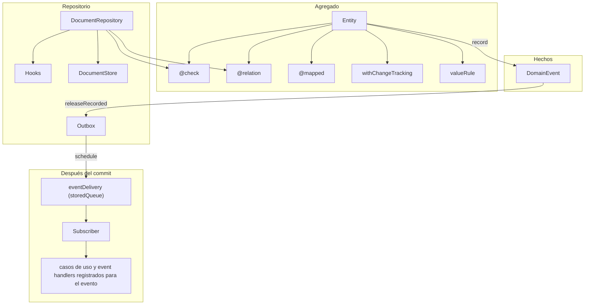
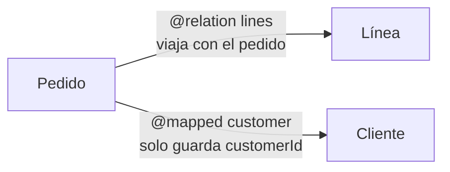

# Agregado, evento y repositorio

El estado de un agregado es el documento SQLite. El evento es el hecho que ese documento registró. El repositorio es quien escribe el documento, corre las reglas y deja en la cola lo que el agregado registró. No es event sourcing: no se reconstruye el estado leyendo el log. No es un broker: los casos de uso y los event handlers registrados para un evento corren en el mismo proceso.

Un teléfono que ya tiene las tablas de eventos no las tira. El store crea la tabla del documento si no existe, y si ya existe agrega `version`, `data` o una columna declarada que falte. Las migraciones de infraestructura corren una vez, anotadas por nombre en `schema_migrations`. El SQL y el nombre se confirman en la misma transacción: si el paso se corta, no queda ninguno de los dos. Una base que ya tiene un nombre que esta app no conoce no se abre. Un wipe olvida solo los nombres de las tablas que borró y las vuelve a correr. El padre guarda los ids de cada `@relation`; la fila del hijo está en su tabla.

## Piezas

| Pieza                      | Dónde                                            | Qué decide                                                                               |
| -------------------------- | ------------------------------------------------ | ---------------------------------------------------------------------------------------- |
| `Entity`                   | `domain/entity/entity.ts`                        | Identidad (`uuid`), `version`, tiempos, `record`                                         |
| `DEFAULT_*`                | estáticos de `Entity`                            | Cómo se lee: su clave, su orden, su display y cómo la encuentra un texto                 |
| `RemoteEntity`             | el mismo archivo                                 | El `id` de Odoo (`remoteId`) y `remoteState`. No reemplaza el `uuid`                     |
| `@check`                   | `domain/entity/checks.ts`                        | Regla sobre campos del propio agregado                                                   |
| `valueRule`                | `domain/entity/values.ts`                        | Predicado de un valor: `parse` / `holds`                                                 |
| `@relation`                | `domain/entity/relations.ts`                     | Otra entidad que viaja con esta. El segundo argumento es `RelationCascade`               |
| `@mapped`                  | `infrastructure/database/mapped.ts`              | Puntero por ids a una entidad que vive sola. Cada lectura reconsulta. No se escribe      |
| `withChangeTracking`       | `domain/entity/change_tracking.ts`               | Diff contra la última lectura. Emite `entity.updated`                                    |
| `DomainEvent`              | `@sincpro/client-framework`                      | El hecho que el agregado registra (`record`), con su `eventName`                         |
| `Subscriber`               | `@sincpro/client-framework` (`subscriberFor`)    | Quién ejecuta un hecho ya guardado: los bounded contexts que lo registraron              |
| `Hook`                     | `domain/repositories/hooks.ts`                   | Qué corre el repositorio alrededor de leer, guardar y borrar                             |
| `IRepository`              | `domain/repositories/repository.ts`              | El puerto: guardar, upsert, borrar, publicar, leer                                       |
| `DocumentRepository`       | `adapters/repositories/document.repository.ts`   | Ese puerto sobre un `DocumentStore`                                                      |
| `SqliteDocumentStore`      | `adapters/repositories/sqlite_document_store.ts` | La fila real: `uuid`, `version`, `data`, columnas declaradas                             |
| `CommandSearchEntities`, … | `services/reads/`                                | Las lecturas de cualquier entidad, sin declarar nada: `Get`, `GetMany`, `Find`, `Search` |
| `Get`, `Search`, …         | `domain/reads/queries.ts`                        | La base de una lectura declarada, cuando el caso de uso tiene una regla propia           |
| `EntityReads`              | `framework/entity_reads.ts`                      | El Feature que las responde desde el repositorio de la entidad. No se escribe            |
| `Outbox`                   | `domain/repositories/document_store.ts`          | `save` del evento en `stored_events` y `schedule` de la entrega (`eventOutbox()`)        |

`StoreMode.LOCAL` guarda el documento y no encola. `StoreMode.RELAY` guarda el documento y deja cada evento que el agregado registró en el outbox, dentro de la misma transacción.

## Cómo se relacionan



## Guardar

`save` es el camino completo. `upsert` reconcilia una fila que vino de afuera: no compara versión, no corre checks y no emite `entity.updated`. Sí corre `before_save`, `after_save` y la misma `RelationCascade`, llamando `upsert` en el hijo.

Un `save`, `upsert` o `remove` abre una sola transacción para todos los documentos de esa llamada, padre e hijos. Si el segundo falla, no queda el primero. Cada llamada tiene su propia sesión: lo que se revierte, lo que se entrega y lo que ya se está guardando no se mezclan con otra llamada. Dos guardados del mismo proceso se esperan en el store. Un hook no puede volver a escribir por el repositorio que lo está corriendo, ni abrir otra escritura mientras esa transacción sigue adentro de un hook.

```mermaid
sequenceDiagram
  participant App
  participant Repo as DocumentRepository
  participant Hook as Hooks
  participant Child as Repositorio del hijo
  participant DB as DocumentStore
  participant Box as Outbox

  App->>Repo: save(entity)
  Repo->>Hook: before_save
  Repo->>Hook: before_create o before_update
  Repo->>Repo: checks del agregado y de cada @relation
  Repo->>Child: según RelationCascade, guarda, actualiza o borra
  Repo->>Repo: recordChanges, si hay snapshot
  Repo->>DB: UPDATE ... WHERE version = esperada, si no upsert
  alt la fila cambió
    Repo-->>App: StaleAggregate
  else sigue
    Repo->>DB: version + 1 y el JSON, relaciones como ids
    Repo->>Box: lo que registró el agregado, si hay outbox
    Repo->>Hook: after_create o after_update
    Repo->>Hook: after_save
    Repo->>Box: schedule, después del commit, si deliver
  end
```

Si `after_save` lanza, la transacción deshace la fila del padre y la de los hijos, y el repositorio devuelve a cada objeto su `version`, sus tiempos, sus eventos y sus `eventIds`. Un reintento no queda viejo ni pierde el hecho.

## Leer

Qué usar para cada lectura, cómo escribir un criteria con el builder y cómo paginar está en [reads.md](reads.md). Acá, cómo lo hace el repositorio.

`get` hidrata y corre `after_read`. `browse`, `search`, `fetchAll` y `searchSql` hidratan cada fila (`after_read`) y después corren `after_search` una vez con la página. `findById`, `findByIds`, `findAll` y `findByCriteria` siguen, deprecados: son `get`, `browse` y `fetchAll`. El criteria se traduce el criteria a SQL en ese momento: una columna declarada se compara por su nombre, y cualquier otro campo con `json_extract` sobre `data`. `today` es la fecha del reloj en su zona y `now` el mismo instante en UTC; los dos se leen una vez al compilar. Un `period` con `between` es `>= inicio AND < fin`. Una relación cruza con `EXISTS`. La colección que ya está en memoria sigue filtrando con el motor de `@sincpro/criteria`. `remoteId`, `remoteState` y `ackedVersion` salen por columna cuando el store las tiene: `sqliteDocuments` las declara si la entidad es `RemoteEntity`.

La hidratación de una `@relation` lee los ids del documento y carga esas filas en el repositorio del hijo. Un JSON viejo que todavía trae el hijo embebido también se acepta. Después anota los ids que el padre tenía y, si el agregado sigue cambios, toma el snapshot. Un `after_read` que rellena un campo entra en ese snapshot: no sale como `entity.updated` en el próximo guardado.

`findByIds`, `findByRemoteIds` y `findByRemoteState` leen con una consulta `IN (…)` cada 500 valores y devuelven lo encontrado en el orden pedido; lo que no existe no está.

### Una página

`search(criteria)` es lo que lee una pantalla: una página, nunca la tabla entera. Es el `repository.search` del backend.

- El orden es el del criteria; si no nombra ninguno, el de la entidad (`DEFAULT_ORDER`). `uuid` lo cierra como desempate en la dirección del primer orden, así dos filas nunca empatan. `NULL` va primero, como lo ordena SQLite.
- 50 filas salvo que `pagination.limit` diga otra cosa. Se lee una más para saber si sigue otra página.
- `strategy: { token }` sigue desde el cursor de la página anterior con un keyset en SQL: igual en los órdenes de antes, más allá en este. El token es el de `@sincpro/criteria` (`mintCursor`), así que un `Reading` y `useReading` hacen "cargar más" igual que contra un servidor. Un token de otro orden se rechaza con `InvalidCriteria` y el `Reading` vuelve a la primera página. `strategy: { rows }` salta filas y no da cursor.
- `count` decide cuánto cuesta: `"none"` no cuenta, `"capped"` (el default) cuenta hasta `COUNT_CEILING` (10 000) y responde `exact: false` pasado eso, `"exact"` cuenta todo.

Devuelve una `EntityCollection` con `cursor` (`null` en la última página) y `total`. `count(criteria)` responde solo el conteo del filtro.

```ts
const asked = criteria<Ticket>().selection(["state", "=", "open"]).limit(20);
const page = await tickets.search(asked);
page.toArray();
page.cursor;
page.total; // { value: 134, exact: true }
const next = await tickets.search(asked.cursor(page.cursor));
```

### Cómo se lee una entidad

La entidad declara cómo se lee, como en el backend. Se sobrescribe solo lo que cambia:

| Estático                   | Default                                  | Lo usa                   |
| -------------------------- | ---------------------------------------- | ------------------------ |
| `DEFAULT_GET_ID()`         | `"uuid"`                                 | `Get`, `GetMany`         |
| `DEFAULT_ORDER()`          | `uuid` descendente: lo más nuevo primero | `search` sin orden       |
| `DEFAULT_DISPLAY()`        | `"name"`                                 | `DEFAULT_LITERAL_SEARCH` |
| `DEFAULT_LITERAL_SEARCH()` | `like` sobre el display                  | `LiteralSearch`          |

```ts
export class Ticket extends RemoteEntity {
  number = "";
  title = "";
  state = "open";

  static override DEFAULT_ORDER() {
    return [{ field: "number", descending: true }];
  }

  static override DEFAULT_LITERAL_SEARCH(): Criteria | null {
    return {
      selection: {
        all: [
          { field: "state", operator: "=", value: "open" },
          {
            any: [
              { field: "number", operator: "starts with", value: TEXT },
              { field: "title", operator: "like", value: TEXT },
            ],
          },
        ],
      },
    };
  }
}
```

`TEXT` es donde va lo que se escribió. Con el texto vacío, las condiciones que lo tienen se caen y el resto (`state = open`) sigue. `null` es que la entidad no se busca: un texto no encuentra nada.

### Leer una entidad: sin declarar nada

Una pantalla o un caso de uso no escribe sus lecturas. El core responde las de **cualquier** entidad que tenga su `DocumentRepository` (`sqliteDocuments(Ticket, …)`): se le pasa la entidad y lo que se pide, y el tipo sale de la entidad.

```ts
import {
  CommandFindEntities,
  CommandGetEntity,
  CommandGetManyEntities,
  CommandSearchEntities,
  commonBoundedContext,
} from "@sincpro/mobile";

const page = await commonBoundedContext.execute(
  new CommandSearchEntities(Ticket, { pagination: { limit: 20 } }),
); // Page<Ticket>: rows, cursor, count
const ticket = await commonBoundedContext.execute(new CommandGetEntity(Ticket, id)); // Ticket
const { records, missing } = await commonBoundedContext.execute(
  new CommandGetManyEntities(Ticket, ids),
);
const options = await commonBoundedContext.execute(new CommandFindEntities(Ticket, typed)); // un select
```

| Command                                          | Responde                                                          |
| ------------------------------------------------ | ----------------------------------------------------------------- |
| `CommandGetEntity(Entity, id, criteria?)`        | La entidad por su clave (`DEFAULT_GET_ID`), o `AggregateNotFound` |
| `CommandGetManyEntities(Entity, ids, criteria?)` | `{ records, missing }`, en el orden pedido                        |
| `CommandFindEntities(Entity, text?, criteria?)`  | `Page<T>` corta (8): lo que un select muestra para el texto       |
| `CommandSearchEntities(Entity, criteria?)`       | `Page<T>`: la página, su cursor y el conteo                       |

Pasan por el bus como cualquier Command: cada una tiene su span (`common/SearchEntities`, con `reads.entity: "Ticket"`), su tipo de falla y su reporte. Desde un caso de uso de la app se ejecutan como hijos de su corrida: `this.commonBoundedContext.execute(new CommandSearchEntities(Ticket, criteria))`.

`Page<T>` es la de `@sincpro/criteria`: `rows`, `cursor`, `count`, `meta` (`null`: el modelo no viaja) y `dropped`. Es la misma forma que responde un `Transport` remoto, así que una pantalla o un `Reading` no saben dónde viven los datos:

```ts
const tickets = resource<Ticket>((criteria) =>
  commonBoundedContext.execute(new CommandSearchEntities(Ticket, criteria)),
);
const { rows, hasMore, more } = useReading(tickets, { pagination: { limit: 20 } }); // @sincpro/criteria-react
```

El `criteria` de quien llama va sobre lo que la entidad lee por default: su filtro se suma, y lo demás que nombra (orden, página, conteo) reemplaza. Lo que la entidad declara (`DEFAULT_*`, arriba) es lo único que se escribe para que se lea bien.

### Cuándo sí se declara un caso de uso de lectura

Solo cuando la lectura **tiene una regla propia**: un alcance (solo los abiertos), un permiso, un nombre que las trazas del módulo deben mostrar en su propio bounded context, u otro repositorio. Entonces tiene su archivo, como cualquier caso de uso: el Command dice qué entidad lee y el Feature hereda la lectura de `EntityReads`.

```ts
// services/ticket/search_open_tickets.feature.ts
export class CommandSearchOpenTickets extends Search(Ticket) {
  constructor(
    criteria: Criteria<Ticket> = {},
    readonly includeClosed = false,
  ) {
    super(criteria);
  }
}

@ticketsBoundedContext.feature(CommandSearchOpenTickets)
export class SearchOpenTickets extends EntityReads<CommandSearchOpenTickets> {
  protected override search(query: CommandSearchOpenTickets) {
    if (query.includeClosed) return super.search(query);
    return super.search(query, {
      selection: { field: "state", operator: "=", value: "open" },
    });
  }
}
```

| Command base            | Construye            | Responde                        |
| ----------------------- | -------------------- | ------------------------------- |
| `Get(Ticket)`           | `(id, criteria?)`    | `Ticket`, o `AggregateNotFound` |
| `GetMany(Ticket)`       | `(ids, criteria?)`   | `{ records, missing }`          |
| `LiteralSearch(Ticket)` | `(text?, criteria?)` | `Page<Ticket>` corta (8)        |
| `Search(Ticket)`        | `(criteria?)`        | `Page<Ticket>`                  |

El alcance (`super.search(query, scope)`) se suma al filtro de quien llama. Lo mismo con `get`, `getMany` y `literalSearch`. Un Feature puede responder varias lecturas de su entidad (`feature([CommandGetTicket, CommandFindTickets])` con `EntityReads<CommandGetTicket | CommandFindTickets>`). Lee del repositorio registrado para la entidad; otro se elige sobrescribiendo `readsFrom(entity)`. `AggregateNotFound` es `not_found`: la ejecución termina `refused` y no se reporta.

Sin regla, no se declara: `CommandSearchEntities(Ticket, …)` ya lo hace, y un `class CommandSearchTickets extends Search(Ticket) {}` vacío solo agrega un nombre.

`findByIdSync` y `findByIdsSync` existen para `@mapped`. No corren hooks: un getter no puede esperar.

La versión que manda es la columna. Una fila vieja sin `version` se lee como versión 1.

## Conciliar con Odoo

`version` sube en cada `save`. `ackedVersion` es la versión que Odoo ya aceptó. El documento está sucio cuando los dos números no coinciden, y también cuando todavía no se guardó (`version` 0). `findDirty` busca esa diferencia en las filas guardadas. `acknowledge` iguala `ackedVersion` a `version` sin subirla: es la respuesta de un push. No emite otro `entity.updated`.

Un pull pasa por `reconcile`. Si el teléfono no tiene ese `remoteId`, el `save` siguiente deja las dos versiones iguales. Si el local está sucio, devuelve `keep` y la fila no se escribe. Si está limpio, `mergeWithRemote` cambia el cuerpo y el `save` vuelve a dejar las versiones iguales. `mergeWithRemote` conserva el `uuid`, los eventos, la `version`, `ackedVersion` y el `createdAt`.

Una fila vieja que ya decía `remoteState` `SYNCED` y no tiene `ackedVersion` se lee como limpia. Una que decía `PENDING` se lee sucia.

En Distribution, `mergeRemoteCustomers` hoy pisa el JSON y `pushCustomersToBackend` busca `PENDING`. Con este repositorio el servicio llama `repository.pull(local, incoming)`: guarda solo cuando el local no está sucio. El push busca `findDirty()` y, cuando Odoo devuelve el id, `repository.acknowledge(customer, remoteId)`. La pantalla sigue leyendo `remoteState`: el `save` lo deja en `PENDING` si el documento está sucio y en `SYNCED` si no. Las columnas del store son `remoteId`, `remoteState` y `ackedVersion`. La app adapta su tabla a esos nombres cuando pasa a este repositorio.

## Eventos

`record` nombra la clase una vez y deduplica por el mismo payload de negocio. El hecho queda en el agregado con su id (el que llevará su sobre), su `sequence` y el `correlationId` del flujo: el id del primero que registró antes del guardado.

En el guardado, `releaseRecorded` saca todo lo que el agregado registró. Los ids que salieron también salen de `eventIds`, así el documento no acumula cada hecho ya entregado. En `LOCAL` sin outbox esos hechos vuelven al agregado y sus ids también. Un repositorio inyectado en un caso de uso está atado a esa ejecución (`BIND`): lo que guarda sigue su flujo y queda causado por ella.

| Modo                               | Qué pasa con lo que el agregado registró                                                             |
| ---------------------------------- | ---------------------------------------------------------------------------------------------------- |
| `RELAY` con outbox                 | Se escribe en la cola dentro de la transacción. `schedule` corre después, si `deliver` no es `false` |
| `LOCAL` sin outbox                 | Vuelve al agregado. No hay cola                                                                      |
| `publish(events)`                  | Puerta explícita. Los guarda como un flujo y llama `schedule`                                        |
| `save(entity, { deliver: false })` | Los persiste y no arranca el drenado. `kick()` lo arranca después                                    |

`entity.updated` (`EntityUpdated`) es un evento más: en `RELAY` entra a la cola y, si ningún bounded context registró un caso de uso para él, queda entregado sin que nadie lo ejecute. El primer guardado de un agregado nuevo no lo emite: no había snapshot.

## Versión

`version === 0` significa que esa instancia nunca se persistió (`isNew`). El guardado compara contra la columna `version`: si no hay fila, espera 0 e inserta; si hay fila, hace `UPDATE ... WHERE uuid = ? AND version = ?`. Si no cambia ninguna fila, `StaleAggregate`. El número nuevo es el de la fila más uno. `INSERT OR REPLACE` no se usa: reemplazar la fila borra y vuelve a crear, y dos lectores pueden ganar los dos.

El padre se escribe después de los hijos. Un cambio en una línea mueve la versión del pedido, así que dos lectores del mismo pedido no pueden guardar los dos.

`upsert` no hace esa comparación. La versión pasa a ser la de la fila más uno, o 1 si no había fila.

`entityVersion` del evento queda vacío. La versión de concurrencia es la del documento, no la de un log.

## Relaciones

Hay dos. No hacen el mismo trabajo.



`@relation` está en `domain/entity/relations.ts`. La otra entidad es parte de esta y tiene fila propia. El documento del padre guarda solo sus ids. Al leer el padre, esos ids se cargan de la tabla del hijo: la fila del hijo es la copia que manda. El hijo necesita su `DocumentRepository` registrado. El diff de `entity.updated` incluye los campos del hijo, no solo el id.

El segundo argumento es `RelationCascade`. Si no se pasa, es `SAVE_AND_REMOVE`: guarda y borra. El editor autocompleta el resto.

| `RelationCascade`   | Al guardar el padre                                           | Al quitarla del arreglo | Al borrar el padre  |
| ------------------- | ------------------------------------------------------------- | ----------------------- | ------------------- |
| `SAVE_AND_REMOVE`   | Crea la nueva y actualiza la que ya existe                    | Borra la fila           | Borra las que tiene |
| `SAVE`              | Crea y actualiza                                              | La deja                 | La deja             |
| `UPDATE`            | Actualiza solo la que ya fue guardada. La nueva no se inserta | La deja                 | La deja             |
| `REMOVE`            | No escribe la fila                                            | Borra la fila           | Borra las que tiene |
| `UPDATE_AND_REMOVE` | Actualiza la que ya existe. La nueva no se inserta            | Borra la fila           | Borra las que tiene |

```ts
class Order extends Entity {
  @relation(Line)
  lines: Line[] = [];
}

class CatalogItem extends Entity {
  @relation(Price, RelationCascade.UPDATE)
  price: Price | null = null;
}
```

`@mapped` está en `infrastructure/database/mapped.ts`. El campo guarda el id. El getter consulta el otro repositorio cada vez que se lee. Guardar el pedido no crea ni borra al cliente. Es la relación con una entidad que tiene vida propia: cliente, producto, pago.

```ts
class SaleOrder extends Entity {
  customerId = "";

  @mapped(EDistributionRepository.CUSTOMER, "customerId")
  get customer(): Customer {
    return undefined as unknown as Customer;
  }
}
```

`entity.events` es un `@mapped`: `eventIds` guarda los ids y el getter los resuelve contra el repositorio de eventos.

Un valor anidado sin `@relation` ni `@mapped` es JSON del documento. No tiene fila propia.

No hay archivar. Borrar es `remove`.

## Checks y valores

`@check` marca el método y la función que nombra los campos que mira. En un guardado corren todas las reglas del agregado y las de cada `@relation` después de `before_save` y de `before_create` o `before_update`, y antes de escribir. Un hook puede llenar el campo que la regla exige. El fallo es `ChecksFailed`, con la ruta (`lines.0`) cuando la regla es del hijo. Una regla que lee otro agregado no es un check: es un `before_save`, que puede leer otro repositorio.

`checkWarnings(entity, touched)` corre solo las reglas cuyos campos se tocaron. Sirve mientras se edita, antes de guardar.

`valueRule(name, holds)` acepta o rechaza un valor. No sustituye a `ValueObject`, que sigue siendo el documento JSON.

## Hooks

| Momento                           | Cuándo                                                                                                |
| --------------------------------- | ----------------------------------------------------------------------------------------------------- |
| `after_read`                      | Cada fila hidratada                                                                                   |
| `after_search`                    | Una vez, con la página de `search`, `findByIds`, `findAll` o `findByCriteria`                         |
| `before_save`                     | Antes de escribir, también en `upsert`                                                                |
| `before_create` / `before_update` | Solo en `save`, según `isNew`                                                                         |
| `after_create` / `after_update`   | Solo en `save`, después de la fila                                                                    |
| `after_save`                      | Después de la fila, también en `upsert`                                                               |
| `before_remove` / `after_remove`  | Alrededor del borrado. `SAVE_AND_REMOVE`, `UPDATE_AND_REMOVE` y `REMOVE` borran las suyas en el medio |

## Qué no es esta capa

No hay borradores ni `refuse_stale`. No hay `DocumentStore` HTTP. Las apps que todavía llaman `addDomainEvent` tienen que pasar a `record` y a este repositorio. Eso es adaptación de la app, no un hueco de esta capa.
