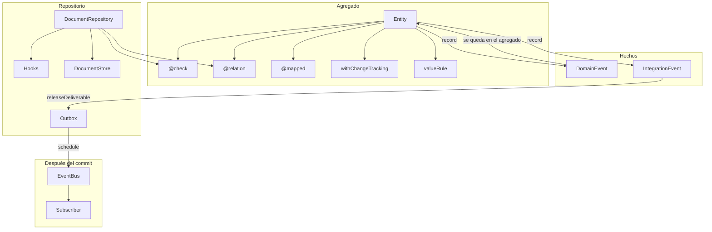
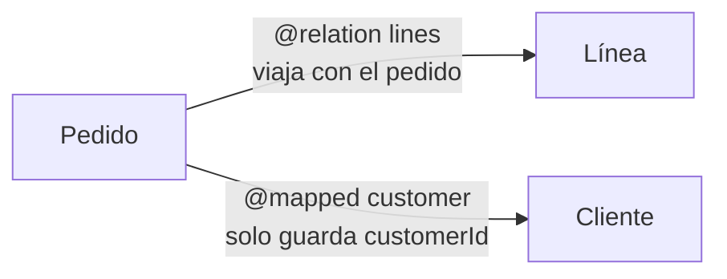

# Agregado, evento y repositorio

El estado de un agregado es el documento SQLite. El evento es el hecho que ese documento registró. El repositorio es quien escribe el documento, corre las reglas y, si el evento es de integración, lo deja en la cola. No es event sourcing: no se reconstruye el estado leyendo el log. No es un broker: los suscriptores corren en el mismo proceso.

Un teléfono que ya tiene las tablas no necesita una migración para esta capa. La versión y los hijos viven dentro del JSON del documento.

## Piezas

| Pieza                 | Dónde                                            | Qué decide                                                                          |
| --------------------- | ------------------------------------------------ | ----------------------------------------------------------------------------------- |
| `Entity`              | `domain/entity/entity.ts`                        | Identidad (`uuid`), `version`, tiempos, `record`                                    |
| `RemoteEntity`        | el mismo archivo                                 | El `id` de Odoo (`remoteId`) y `remoteState`. No reemplaza el `uuid`                |
| `@check`              | `domain/entity/checks.ts`                        | Regla sobre campos del propio agregado                                              |
| `valueRule`           | `domain/entity/values.ts`                        | Predicado de un valor: `parse` / `holds`                                            |
| `@relation`           | `domain/entity/relations.ts`                     | Otra entidad que viaja con esta. El segundo argumento es `RelationCascade`          |
| `@mapped`             | `infrastructure/database/mapped.ts`              | Puntero por ids a una entidad que vive sola. Cada lectura reconsulta. No se escribe |
| `withChangeTracking`  | `domain/entity/change_tracking.ts`               | Diff contra la última lectura. Emite `entity.updated`                               |
| `DomainEvent`         | `domain/events/`                                 | El hecho. Se queda en el agregado                                                   |
| `IntegrationEvent`    | `domain/events/integration_event.ts`             | El mismo hecho, entregable. Va a la cola                                            |
| `Subscriber`          | `event_driven/subscriber.ts`                     | Quién escucha un hecho ya encolado                                                  |
| `Hook`                | `domain/repositories/hooks.ts`                   | Qué corre el repositorio alrededor de leer, guardar y borrar                        |
| `IRepository`         | `domain/repositories/repository.ts`              | El puerto: guardar, upsert, borrar, publicar, leer                                  |
| `DocumentRepository`  | `adapters/repositories/document.repository.ts`   | Ese puerto sobre un `DocumentStore`                                                 |
| `SqliteDocumentStore` | `adapters/repositories/sqlite_document_store.ts` | La fila real: `uuid`, `data`, columnas declaradas                                   |
| `Outbox`              | `domain/repositories/document_store.ts`          | `save` del evento y `schedule` de la cola                                           |

`StoreMode.LOCAL` guarda el documento y no encola. `StoreMode.RELAY` guarda el documento y deja cada `IntegrationEvent` en el outbox, dentro de la misma transacción.

## Cómo se relacionan



## Guardar

`save` es el camino completo. `upsert` reconcilia una fila que vino de afuera: no compara versión, no corre checks, no cae a los hijos y no emite `entity.updated`. Sí corre `before_save` y `after_save`.

```mermaid
sequenceDiagram
  participant App
  participant Repo as DocumentRepository
  participant Hook as Hooks
  participant Child as Repositorio del hijo
  participant DB as DocumentStore
  participant Box as Outbox

  App->>Repo: save(entity)
  Repo->>Repo: checks del agregado y de cada @relation
  Repo->>Hook: before_save
  Repo->>Hook: before_create o before_update
  Repo->>Child: según RelationCascade, guarda, actualiza o borra
  Repo->>Repo: recordChanges, si hay snapshot
  Repo->>DB: version esperada, si no upsert
  alt la fila cambió
    Repo-->>App: StaleAggregate
  else sigue
    Repo->>DB: version + 1 y el JSON
    Repo->>Box: IntegrationEvent, si hay outbox
    Repo->>Hook: after_create o after_update
    Repo->>Hook: after_save
    Repo->>Box: schedule, si deliver
  end
```

Si `after_save` lanza, la transacción deshace la fila y el repositorio devuelve al objeto su `version`, sus tiempos y sus eventos. Un reintento no queda viejo ni pierde el hecho.

Un hook no puede volver a escribir por el mismo repositorio. Eso corta el ciclo de guardar dentro de `before_save`.

## Leer

`findById` hidrata y corre `after_read`. `findByIds`, `findAll` y `findByCriteria` hidratan cada fila (`after_read`) y después corren `after_search` una vez con la página. El filtro de `findByCriteria` corre en memoria sobre los documentos ya leídos. No hay compilador SQL.

La hidratación reconstruye cada `@relation` desde el JSON anidado, anota los ids que el padre tenía y, si el agregado sigue cambios, toma el snapshot. Un `after_read` que rellena un campo entra en ese snapshot: no sale como `entity.updated` en el próximo guardado.

Una fila vieja sin `version` se lee como versión 1.

## Eventos

`record` nombra la clase una vez y deduplica por el mismo payload de negocio. El hecho queda en el agregado con `entityType`, `aggregateId`, `sequence` y la cadena de correlación.

En el guardado, `releaseDeliverable` saca los `IntegrationEvent` y deja los `DomainEvent`.

| Modo                               | Qué pasa con el IntegrationEvent                                                                     |
| ---------------------------------- | ---------------------------------------------------------------------------------------------------- |
| `RELAY` con outbox                 | Se escribe en la cola dentro de la transacción. `schedule` corre después, si `deliver` no es `false` |
| `LOCAL` sin outbox                 | Vuelve al agregado. No hay cola                                                                      |
| `publish(events)`                  | Puerta explícita. Los escribe y llama `schedule`                                                     |
| `save(entity, { deliver: false })` | Los persiste y no arranca el drenado. `kick()` lo arranca después                                    |

`entity.updated` extiende `DomainEvent`. No entra a la cola. El primer guardado de un agregado nuevo no lo emite: no había snapshot.

## Versión

`version === 0` significa que esa instancia nunca se persistió (`isNew`). El guardado compara contra la fila: si no hay fila, espera 0; si hay fila, espera el número guardado. Si no coincide, `StaleAggregate`. El número nuevo es el de la fila más uno.

El padre se escribe después de los hijos. Un cambio en una línea mueve la versión del pedido, así que dos lectores del mismo pedido no pueden guardar los dos.

`upsert` no hace esa comparación. La versión pasa a ser la de la fila más uno, o 1 si no había fila.

`entityVersion` del evento queda vacío. La versión de concurrencia es la del documento, no la de un log.

## Relaciones

Hay dos. No hacen el mismo trabajo.



`@relation` está en `domain/entity/relations.ts`. La otra entidad es parte de esta: tiene fila propia y también va dentro del JSON del padre. Al leer el padre, sale de ese JSON. El hijo necesita su `DocumentRepository` registrado.

El segundo argumento es `RelationCascade`. Si no se pasa, es `SAVE_AND_REMOVE`: guarda y borra. El editor autocompleta el resto.

| `RelationCascade`   | Al guardar el padre                                           | Al quitarla del arreglo | Al borrar el padre  |
| ------------------- | ------------------------------------------------------------- | ----------------------- | ------------------- |
| `SAVE_AND_REMOVE`   | Crea la nueva y actualiza la que ya existe                    | Borra la fila           | Borra las que tiene |
| `SAVE`              | Crea y actualiza                                              | La deja                 | La deja             |
| `UPDATE`            | Actualiza solo la que ya fue guardada. La nueva no se inserta | La deja                 | La deja             |
| `REMOVE`            | No escribe la fila                                            | Borra la fila           | Borra las que tiene |
| `UPDATE_AND_REMOVE` | Actualiza la que ya existe. La nueva no se inserta            | Borra la fila           | Borra las que tiene |

```ts
class Order extends Entity {
  @relation(Line)
  lines: Line[] = [];
}

class CatalogItem extends Entity {
  @relation(Price, RelationCascade.UPDATE)
  price: Price | null = null;
}
```

`@mapped` está en `infrastructure/database/mapped.ts`. El campo guarda el id. El getter consulta el otro repositorio cada vez que se lee. Guardar el pedido no crea ni borra al cliente. Es la relación con una entidad que tiene vida propia: cliente, producto, pago.

```ts
class SaleOrder extends Entity {
  customerId = "";

  @mapped(EDistributionRepository.CUSTOMER, "customerId")
  get customer(): Customer {
    return undefined as unknown as Customer;
  }
}
```

`entity.events` es un `@mapped`: `eventIds` guarda los ids y el getter los resuelve contra el repositorio de eventos.

Un valor anidado sin `@relation` ni `@mapped` es JSON del documento. No tiene fila propia.

No hay archivar. Borrar es `remove`.

## Checks y valores

`@check` marca el método y la función que nombra los campos que mira. En un guardado corren todas las reglas del agregado y las de cada `@relation`, antes de escribir. El fallo es `ChecksFailed`, con la ruta (`lines.0`) cuando la regla es del hijo. Una regla que lee otro agregado no es un check: es un `before_save`, que puede usar otro repositorio.

`checkWarnings(entity, touched)` corre solo las reglas cuyos campos se tocaron. Sirve mientras se edita, antes de guardar.

`valueRule(name, holds)` acepta o rechaza un valor. No sustituye a `ValueObject`, que sigue siendo el documento JSON.

## Hooks

| Momento                           | Cuándo                                                                                                |
| --------------------------------- | ----------------------------------------------------------------------------------------------------- |
| `after_read`                      | Cada fila hidratada                                                                                   |
| `after_search`                    | Una vez, con la página de `findByIds`, `findAll` o `findByCriteria`                                   |
| `before_save`                     | Antes de escribir, también en `upsert`                                                                |
| `before_create` / `before_update` | Solo en `save`, según `isNew`                                                                         |
| `after_create` / `after_update`   | Solo en `save`, después de la fila                                                                    |
| `after_save`                      | Después de la fila, también en `upsert`                                                               |
| `before_remove` / `after_remove`  | Alrededor del borrado. `SAVE_AND_REMOVE`, `UPDATE_AND_REMOVE` y `REMOVE` borran las suyas en el medio |

## Qué no es esta capa

El criterio no se compila a SQL. No hay borradores ni `refuse_stale`. No hay `DocumentStore` HTTP. No hay registro de migraciones. Las apps que todavía llaman `addDomainEvent` tienen que pasar a `record` y a este repositorio. Eso es adaptación de la app, no un hueco de esta capa.
