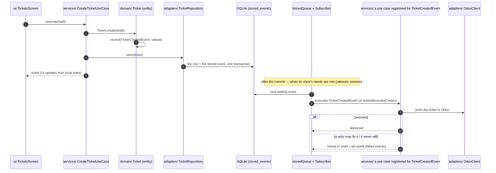

# Consumer Architecture — how to structure an app on `@sincpro/mobile`

> This is the **recommended shape** for a business app built on the framework.
> The framework gives you the runtime (queues, events, cron, DB, telemetry, UI kit);
> your job is to fill four layers — **adapters, the bounded context, services, ui** — and
> wire them with a `DomainModule`. Everything below is convention, not magic: it
> exists so an app stays testable, swappable, and navigable as it grows.

---

## 1. Mental model — hexagonal, one bounded context per module

The framework owns the **center** (orchestrator, kernel, event bus, DB, telemetry).
Your app plugs into it as a `DomainModule` and provides the **edges**.

```mermaid
flowchart TB
    subgraph APP["Your app (a DomainModule)"]
        direction TB
        ui["ui/<br/>screens — render only,<br/>uses @sincpro/mobile-ui"]
        svc["services/<br/>use cases · workflows<br/>(business logic, also what an event triggers)"]
        infra["infrastructure/<br/>dependencies.ts + framework.ts<br/>ticketsBoundedContext"]
        adp["adapters/<br/>external services + repositories<br/>(implement ports)"]
        dom["domain/<br/>entities · value objects · events · port interfaces"]
    end

    subgraph FW["@sincpro/mobile (framework runtime)"]
        kernel["Orchestrator / Kernel"]
        bus["storedQueue (client-framework) · eventDelivery"]
        db["DBCursor + migrations (SQLite)"]
        tel["Tracing / telemetry"]
    end

    uikit[["@sincpro/mobile-ui<br/>design system"]]
    ext[["External systems<br/>(Odoo / REST / BLE printer)"]]

    ui --> svc
    ui -.->|components| uikit
    svc -->|registers on · inherits dependencies| infra
    infra -.->|supplies| adp
    svc --> dom
    svc --> adp
    adp -->|implements ports from| dom
    adp -->|SQLite via| db
    adp -->|HTTP/BLE| ext
    dom -->|record → stored with the save| bus
    bus -->|one Subscriber → the use cases registered for the event| svc
    kernel -->|wires module hooks| APP
    svc -.->|@TraceClass / @Trace| tel
```

**The one rule:** dependencies point **inward**. `ui` → `services` → `domain`;
`adapters` implement interfaces declared in `domain`. `domain` imports nothing
outward. This is what lets you unit-test a use case with a fake repository and swap
the Odoo adapter for a REST one without touching business logic.

---

## 2. Folder layout

```
sincpro_mobile_myapp/
├── app/
│   └── index.tsx                ← calls createMyApp(), exports default
└── sincpro_mobile_myapp/
    ├── entrypoints/
    │   ├── main.tsx             ← DomainModule class + createMyApp()
    │   └── cron/                ← CronWorkers whose jobs execute a Command
    ├── domain/                  ← entities, value objects, domain events, PORT interfaces
    │   ├── ticket.entity.ts
    │   ├── events.ts            ← TicketCreatedEvent, SyncTicketEvent (extend DomainEvent)
    │   └── ports.ts             ← ITicketRepository, IOdooClient (interfaces only)
    ├── adapters/
    │   ├── repositories/        ← ITicketRepository impl (SQLite via DBCursor + mapped)
    │   └── external/            ← OdooClient / ApiClient impl (HTTP), PrinterAdapter (BLE)
    ├── services/
    │   ├── index.ts             ← imports every service (it registers itself); exports ticketsBoundedContext
    │   └── ticket/              ← one folder per aggregate: Features, ApplicationServices
    │       └── lines/           ← an entity of the aggregate with use cases of its own
    ├── infrastructure/
    │   ├── dependencies.ts      ← TicketsDependencies + registerDependencies
    │   └── framework.ts         ← servicesWith<TicketsDependencies>() bases + ticketsBoundedContext
    └── ui/
        ├── screens/             ← TicketsScreen (composes mobile-ui)
        └── theme/tokens.ts
```

Events have no doors of their own: registering a use case for an event is its subscription, and
the queue has one `Subscriber` — the framework's.

---

## 3. The four layers

### `adapters/` — external services & repositories (implement ports)

Adapters are the only place that knows about the outside world (SQLite, HTTP, BLE).
They **implement interfaces declared in `domain/`**, so the rest of the app depends on
the interface, not the implementation.

```ts
// domain/ports.ts — the contract (no implementation)
export interface ITicketRepository {
  save(ticket: Ticket): Promise<void>;
  findPending(): Promise<Ticket[]>;
}

// adapters/repositories/ticket.repository.ts — SQLite implementation
import { DBCursor } from "@sincpro/mobile/infrastructure/database";

export class TicketRepository implements ITicketRepository {
  async save(ticket: Ticket): Promise<void> {
    await DBCursor.mutateDatabase(
      `INSERT INTO tickets (id, status, payload) VALUES (?, ?, ?)`,
      ticket.id,
      ticket.status,
      JSON.stringify(ticket.toJSON()),
    );
  }
  async findPending(): Promise<Ticket[]> {
    /* getAllAsync + map rows → entities */
  }
}

// adapters/external/odoo.client.ts — HTTP implementation of an outbound port
export class OdooClient implements IOdooClient {
  /* fetch(...) */
}
```

**Why ports/adapters:** swap SQLite↔remote or Odoo↔REST without touching use cases;
unit-test business logic with an in-memory fake. The framework's own `DBCursor`,
`mapped`/`resolveEntity` helpers live under `@sincpro/mobile/infrastructure/database`.

### `infrastructure/` — the bounded context

As the backend's `dependencies.py` + `framework.py`: the dependencies are declared once, and
every use case of the context finds them on `this`. A bounded context is named for what it is —
`ticketsBoundedContext`, never `ctx` or `bc`.

```ts
// infrastructure/dependencies.ts
import type { BoundedContext } from "@sincpro/client-framework";

export interface TicketsDependencies {
  tickets: ITicketRepository;
  odoo: IOdooClient;
}

export function registerDependencies(
  boundedContext: BoundedContext<TicketsDependencies>,
): BoundedContext<TicketsDependencies> {
  boundedContext.addDependency("tickets", new TicketRepository());
  boundedContext.addDependency("odoo", new OdooClient());
  return boundedContext;
}

// infrastructure/framework.ts
import { BoundedContext, servicesWith } from "@sincpro/client-framework";

export const { Feature, ApplicationService } = servicesWith<TicketsDependencies>();
export const ticketsBoundedContext = registerDependencies(
  new BoundedContext<TicketsDependencies>("tickets"),
);
```

The instance lives in `framework.ts`, not in `services/index.ts`: a service imports it to
register itself, and ES modules run their imports first.

### `services/` — use cases & workflows (business logic)

A **use case** is one business transaction: load entities via repositories, run domain
logic, persist, and let entities emit domain events. It is a `Feature` that registers itself
on the module's bounded context, with a decorator, for its `Command` — or for N DTOs. A
**workflow** — several use cases with decisions between them — is an `ApplicationService` that
composes Features through `this.featureBus`. Neither declares a dependency nor a name: they
inherit the context's, and the name is the class's, taken at registration — so the host keeps
class names in production (`keep_classnames: true` in `metro.config.js`). Every run is a span
(`<context>/<Class>`, e.g. `tickets/CreateTicket`), logs through `this.logger` and is reported
once when it fails unexpectedly; nothing else opens spans.

```ts
// services/ticket/create_ticket.feature.ts
import { Command } from "@sincpro/client-framework";
import { Feature, ticketsBoundedContext } from "../../infrastructure/framework";

export class CommandCreateTicket extends Command<Ticket> {
  constructor(readonly input: CreateTicketInput) {
    super();
  }
}

@ticketsBoundedContext.feature(CommandCreateTicket)
export class CreateTicket extends Feature<CommandCreateTicket, Ticket> {
  async execute(command: CommandCreateTicket): Promise<Ticket> {
    const ticket = Ticket.create(command.input);
    await this.tickets.save(ticket); // inherited from TicketsDependencies
    return ticket;
  }
}

// services/ticket/sync_day.ts — a workflow
@ticketsBoundedContext.appService(CommandSyncDay)
export class SyncDay extends ApplicationService<CommandSyncDay, void> {
  async execute(command: CommandSyncDay): Promise<void> {
    await this.featureBus.execute(new CommandCreateTicket(command.input)); // child span
  }
}

// services/index.ts — importing it registers every use case: what the module and screens import
export { ticketsBoundedContext } from "../infrastructure/framework";
export * from "./ticket/create_ticket.feature";
export * from "./ticket/sync_day";

await ticketsBoundedContext.execute(new CommandCreateTicket(input)); // from a screen
```

Services live in one folder per aggregate (`services/ticket/`); an entity of that aggregate with
use cases of its own gets a folder inside it (`services/sale_order/payments/`).

**Why a thin use-case layer:** it's the seam the UI, the queue and the crons all reach — a screen
and a cron build a Command and execute it; the queue's one `Subscriber` executes the event on the
use cases registered for it —, the unit of a transaction, and where tracing, logging and error
reporting happen. Keep it free of React and of SQL — it speaks domain + ports only.

#### Events — a use case registered for them

Nobody writes a subscriber per event. A use case registered for an event hears it _after_ the
transaction stored it: registering it is the subscription, and while the module's domain is
active the queue's one `Subscriber` hands it the event. When a screen does the same work, the use
case takes both DTOs. Its decision is that Feature's; several use cases with decisions between
them are an ApplicationService. Whether the event may go now (a connection, a session) is
declared by the **event's class**.

```ts
// domain/events.ts
export class TicketClosedEvent extends DomainEvent {
  static readonly eventName = "tickets.ticket.v1.closed";
  static readonly label = "Ticket cerrado";
  static readonly requiresNetwork = true; // waits for a connection
  ticketId = "";
}

// services/ticket/sync_ticket.feature.ts — a screen executes it, and the event triggers it
export class CommandSyncTicket extends Command<void> {
  constructor(readonly ticketId: string) {
    super();
  }
}

@ticketsBoundedContext.feature([CommandSyncTicket, TicketClosedEvent])
export class SyncTicket extends Feature<CommandSyncTicket | TicketClosedEvent, void> {
  async execute(request: CommandSyncTicket | TicketClosedEvent): Promise<void> {
    await this.odoo.syncTicket(request.ticketId); // at least once: keyed by the ticket
  }
}
```

You never publish to deliver a result: a caller that needs the answer executes the use case
(`ticketsBoundedContext.execute(...)`). The queue retries what a retry may fix and sets aside
what never will — the failed events a person retries. Delivery is at least once: a use case
keys its effect by the entity, or by `this.execution.causationId` (the message's id).

### `ui/` — screens (render only)

Screens compose `@sincpro/mobile-ui` components and call use cases. **No business logic,
no SQL, no fetch** in the UI — it reads state and dispatches intents.

```tsx
import { Screen, Button, ListItem } from "@sincpro/mobile-ui";

export function TicketsScreen() {
  const onCreate = () => ticketsBoundedContext.execute(new CommandCreateTicket(draft)); // a use case
  return (
    <Screen>
      {pending.map((t) => (
        <ListItem key={t.id} title={t.code} />
      ))}
      <Button onPress={onCreate}>New ticket</Button>
    </Screen>
  );
}
```

The host's router renders the screen: an Expo Router file under `app/` imports it and passes
its callbacks. The library never knows the route; when the active domain changes, the shell tells
the host (`onDomainChange`) and the host navigates. 2.0 removed the app shell's `ui` map.

---

## 4. Wiring — the `DomainModule` ties the layers together

The module is the single registration point. The framework reads its hooks during boot
(repositories → migrations → bounded contexts → crons); while its domain is active, its bounded
contexts hear the stored queue through its one `Subscriber`.

```ts
export class TicketsModule extends DomainModule {
  readonly key = "TICKETS";
  readonly name = "Tickets";

  override repositories() {
    return { ticketRepo: new TicketRepository() };
  }
  override migrations() {
    return [CreateTicketsTable];
  }
  override boundedContexts() {
    return [ticketsBoundedContext]; // imported from services/index.ts: every use case registered
  }
  override crons() {
    return [SyncPendingTicketsCron];
  }
  override persistOnReset() {
    return ["ticket_templates"];
  } // survive logout wipe
}
```

A Command that a message from outside may carry (`eventDelivery.receive`, CloudEvents 1.0) runs
only when the module declares it — `override consumes() { return [CommandSyncTicket]; }` —; none
by default, as the backend's `@queue.consumes`.

---

## 5. Sequence — a typical request, end to end

Shows the layers cooperating: UI dispatches an intent, a use case runs domain logic and
persists, the entity's domain event is queued, and the use case registered for it performs
the side effect later (and offline-safely).



**Why this shape:** the UI returns immediately from local state (offline-first); the side
effect (Odoo sync) is decoupled, retried, and survives app restarts because the event was
persisted before processing. The use case stayed pure and testable; the network detail
lives in one adapter.

---

## 6. Checklist for a new feature

1. **Domain** — model the entity + the events it emits + the port interfaces it needs.
2. **Adapters** — implement the repository (SQLite) and any external client (HTTP/BLE).
3. **Services** — write the use case (one transaction) with its decorator (`@ticketsBoundedContext.feature(CommandX)`) and import it in `services/index.ts`; add a workflow if multi-step. A new dependency goes in `infrastructure/dependencies.ts`, never in the Feature.
4. **UI** — a screen that executes the use case's Command, built from `@sincpro/mobile-ui`.
5. **Events** — for each side effect, a use case registered for the event (`feature([CommandX, TheEvent])`), never a subscriber; readiness on the event's class.
6. **Module** — register repositories, migrations, `boundedContexts()` (from `services/index.ts`), `consumes()` only for Commands a message from outside carries, and crons.
7. **Telemetry** — every `Feature` / `ApplicationService` run already opens its span (`createKernel` configures the process). Shipping it is still opt-in: `createApp({ telemetry })` with an `otlp` endpoint. `@Tracing.TraceClass` remains for a class that is not a use case.
