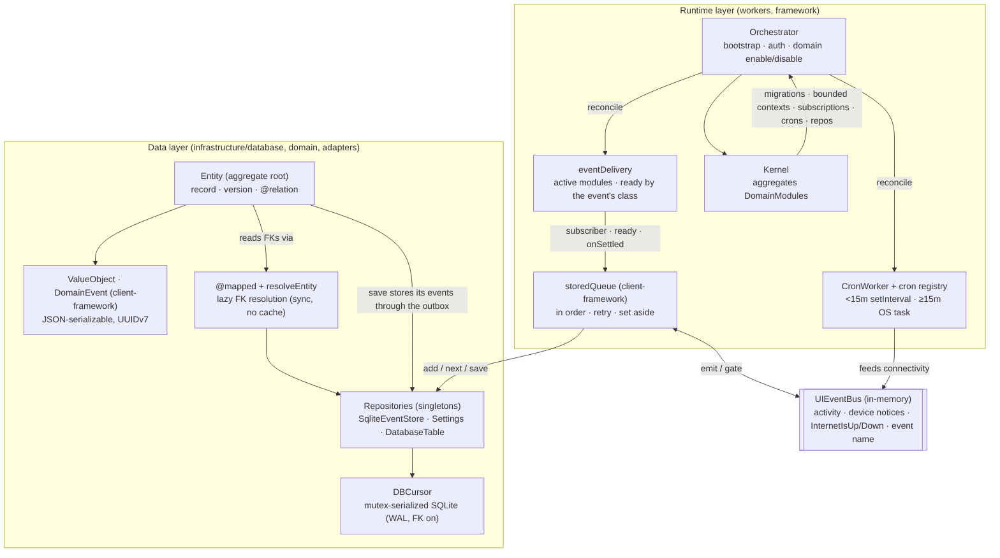
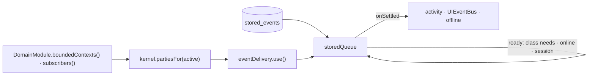

# Core Architecture

> The framework's center: how a document aggregate is stored, how a save records
> facts, how those facts are delivered (a persistent queue + in-process subscribers),
> how recurring work runs (cron), and how it all boots (AppShell → Orchestrator → Kernel).
> The aggregate, its checks, its hooks and its repository are specified in
> [architecture-aggregate.md](architecture-aggregate.md).

## The client, shared with the web

The process a screen runs in is `@sincpro/client-framework` (a `peerDependency`, `^1.2.0`):
the bounded contexts, their Features and ApplicationServices, the domain events, the stored
queue that delivers them, failure kinds, the tracer and the layer loggers. This package is the
phone shell around that same process: SQLite, the stored queue's table, cron, `AppShell`, the
telemetry exporters. It does not own a second client.

- `createKernel` configures the process once (`configureObservability`): spans through
  OpenTelemetry's global tracer (this package's SQLite → OTLP queue), lines through the console
  and Loki (`mobileLogger`).
- Events are the framework's `DomainEvent` (`static eventName`); delivery is its
  `storedQueue` over `SqliteEventStore`; who hears them is the active modules' bounded
  contexts and `Subscriptions`.
- Still not built: a `ContextStore` (MMKV) and a `Transport` over SQLite for
  `screensTransport`.

`sincpro-client check` applies to an app laid out as `domains/<context>/<layer>`, not to this shell.

---

## 1. The big picture — one stored queue, one UI signal bus

There are **two message paths**, and they do different jobs.

|              | Stored queue (domain)                                               | `UIEventBus` (UI signals)                                                                      |
| ------------ | ------------------------------------------------------------------- | ---------------------------------------------------------------------------------------------- |
| Backing      | **SQLite** (`stored_events`) — survives restarts                    | In-memory (`mitt`) — ephemeral                                                                 |
| Carries      | Domain events (durable, at-least-once, in order)                    | Activity facts, device notices, `InternetIsUp/Down`, and the event name (screens reload on it) |
| Failure mode | Retried when a retry may fix it, else set aside (the failed events) | Fire-and-forget. Screen listeners debounce 300 ms. Activity does not.                          |

The stored queue is `@sincpro/client-framework`'s `storedQueue`; this package plugs its store
(`SqliteEventStore`) and its delivery (`eventDelivery`), which **emits to** and **listens
from** the `UIEventBus` (it marks the phone offline on a `NETWORK_DOWN` failure and lets what
needs a connection go on `InternetIsUp`). Business-critical data lives only in the stored
queue — never in telemetry or UI signals.



---

## 2. The "almost-ORM" — `DBCursor` + `@mapped`

There is **no ORM**. There's a thin, deliberate seam over `expo-sqlite`.

**`DBCursor`** (`infrastructure/database/connector.ts`) — a small object exposing
`mutateDatabase` / `getFirstAsync` / `getAllAsync` / `execAsync` (async, **serialized by an
`async-mutex`**) plus sync variants (`getFirstSync` / `getAllSync`, **not** mutex-guarded).
Every connection opens with `PRAGMA journal_mode = WAL` and `foreign_keys = ON`. Query
logging skips the queue/telemetry tables to avoid a write-amplification loop (a failing
log insert that logs an error that tries to insert again).

**`@mapped` + `resolveEntity`** (`infrastructure/database/mapped.ts`) — a property decorator
that turns a stored foreign-key column into a live entity reference:

```ts
class Ticket extends Entity {
  lineIds: string[] = [];
  @mapped(ECommonRepository.TICKET_LINE, "lineIds")
  get lines(): TicketLine[] {
    return undefined as never;
  } // body replaced by the decorator
}
```

Reading `ticket.lines` synchronously queries SQLite by `lineIds` and rehydrates the rows
into entities — **every access, no caching**.

| Decision                                       | Why                                                                                                                                                           |
| ---------------------------------------------- | ------------------------------------------------------------------------------------------------------------------------------------------------------------- |
| Async path serialized by a single Mutex        | SQLite is single-writer; the mutex prevents interleaved writes/corruption across the app's concurrent flows                                                   |
| `@mapped` never caches (always re-queries)     | Always-fresh data, zero stale-cache bugs, no memory overhead — at the cost of a sync main-thread read (documented limitation: scalar/array FK only, no joins) |
| Repository facade injected lazily at bootstrap | Breaks the circular import between entities (need repos) and repos (need entities)                                                                            |
| UUID **v7** for ids                            | Minted by `@sincpro/client-framework` as 32 hex, the same key the server accepts. Time-ordered, so ordering by `id` is ordering by creation                   |

---

## 3. Entity model

An **`Entity`** is a document aggregate (`domain/entity/entity.ts`). Its state is the row.
`record(EventClass, values)` keeps a framework `DomainEvent` on the instance, with its id and
its place in the flow (`RecordedEvents`: one save, one `correlationId`). In relay mode
`DocumentRepository.save` writes the row and stores every recorded event through the outbox —
`SqliteEventStore.add`, on the same connection, inside the same transaction —, then asks
for the delivery after the commit. Bound to a run (`BIND`), the repository's events continue
that run's flow. The full sequence — checks, hooks, relations, version, explicit `publish` —
is [architecture-aggregate.md](architecture-aggregate.md).

`entity.events` resolves the ids it still names live from `stored_events` via `@mapped`.

---

## 4. Default repositories

Document aggregates go through `DocumentRepository` (`sqliteDocuments`). The queue,
settings and table introspection stay hand-written singletons over `DBCursor`. They are
not the aggregate port. `IRepository` / `IRemoteRepository` live in
`domain/repositories/repository.ts`.

| Repository                | Table           | Role                                                                                                                                      |
| ------------------------- | --------------- | ----------------------------------------------------------------------------------------------------------------------------------------- |
| `SqliteEventStore`        | `stored_events` | The stored queue's `EventStore` (`add`, `next`, `save`), and what the screens read: recent, failed (`set_aside`), retry, prune, `@mapped` |
| `SettingsRepository`      | `settings`      | Typed key/value store (`JSON.stringify` + `type` column)                                                                                  |
| `DatabaseTableRepository` | `sqlite_master` | Introspection only (list tables, dump rows)                                                                                               |

---

## 5. Stored queue + delivery — the framework's rules, the phone's needs

**`storedQueue`** (`@sincpro/client-framework`) delivers what `SqliteEventStore` keeps, one
at a time and in the order added, to every party that hears it and does not have it yet. A
failure a retry may fix (`unavailable`, `unknown_outcome`…) is retried after a backoff and holds
the line; one that never will (`invalid`, `domain`, `not_found`…) is set aside and never holds
back the rest; after ten attempts the rest is set aside too. Delivery is at least once.

**`eventDelivery`** (`infrastructure/events/delivery.ts`) is what the phone adds:

- **Who hears.** The orchestrator puts the active domains' parties behind one `Subscribes`
  (`use(kernel.partiesFor(activeDomains))`): their bounded contexts — use cases whose input is
  the event — and their `Subscriptions` — the `EventSubscriber` entrypoints that build a
  Command. One queue, one drainer, for the life of the app.
- **When.** `ready` asks the event's **class**: `requiresNetwork` waits for a connection,
  `requiresSession` (the default) for a signed-in session. It waits while the rest go on and
  goes as soon as what it needs comes back — `InternetIsUp`, a login, the app in the foreground.
- **What it tells.** `onSettled` publishes the activity, emits the event's name on the
  `UIEventBus` for the screens, and marks the phone offline on a `NETWORK_DOWN` failure.



A caller that needs the answer does not publish: it executes the use case on its bounded
context (`xBoundedContext.execute(new Command(...))`), which answers or throws.

---

## 6. Cron — the 15-minute split

**`CronWorker`** (`infrastructure/workers/CronWorker.ts`) hides a platform reality behind one
constructor (`taskName`, `job`, `intervalMin = 15`, `requiresAuth`):

- **`intervalMin < 15`** → JS `setInterval` (foreground, fires immediately + on interval).
- **`intervalMin ≥ 15`** → real OS background task via `expo-background-task` + `expo-task-manager`
  (15 min is the OS floor for background scheduling on iOS/Android).

**Background tasks are defined at load time.** When the OS wakes a closed app to run a task it
evaluates the bundle **without mounting React**: `createApp` never runs and the task is looked up
by name. So `defineAppShell(config)` (called while the bundle loads) builds the kernel with
`createKernel` and calls `defineBackgroundCrons(kernel)`, which defines one task per background
cron. Each run awaits `kernel.bootstrap()` (repositories + migrations, once per JS context) before
the job. Registering with the scheduler stays with `cron.sync`, so domain and auth gates still
decide whether the OS calls it at all. A background cron created later (outside any
`DomainModule`) is defined on `start()` with a warning: it works in foreground only.

The **`cron`** registry is a reconciler: `cron.sync(domains, auth, cronsByKey)` reconciles
the running cron set, with the same domain + auth gates, calling `waitForIdle()` before
unregistering. Example: `CHECK_NETWORK` runs every 2.5 min (setInterval path, no auth) and
feeds the `InternetIsUp/Down` signals that the delivery and the telemetry flush read.

---

## 7. Composition & boot — AppShell → Orchestrator → Kernel

- **`DomainModule`** — a module of the app. Hooks: `repositories()`, `migrations()`,
  `boundedContexts()`, `subscribers()` (its `Subscriptions`), `crons()`, `persistOnReset()`.
  `shared` modules sort first and can't be disabled.
- **`BaseModule`** (`key="COMMON"`, `shared`) — always on; provides the base repositories,
  migrations, `commonBoundedContext` with `commonSubscriptions`, and `CHECK_NETWORK`. It marks `telemetry_queue` + `spans_queue`
  as `persistOnReset` so telemetry generated during logout still ships.
- **`Kernel`** — aggregates modules (shared-first), merges their hooks, and runs migrations.
  Each migration commits its SQL and its name in one transaction. A database that already
  has a name this app does not know does not open. `restartDatabase()` drops all but
  `persistOnReset` tables on logout-with-wipe.
- **`Orchestrator`** — the runtime brain: `bootstrap()`, `authenticateSession()`, runtime
  `enableDomain/disableDomain` (mutex-serialized), and an AppState watcher that puts the
  active parties behind the queue, drains it and reconciles cron whenever the app foregrounds.

```mermaid
sequenceDiagram
    autonumber
    participant Entry as app/_layout (module scope)
    participant Def as defineAppShell
    participant Shell as AppShell (React)
    participant CA as startApp
    participant K as Kernel
    participant O as Orchestrator
    participant QP as eventDelivery
    participant CR as cron
    participant Tel as initTelemetry

    Entry->>Def: defineAppShell(config)
    Note over Def: sync — theme / branding / fonts, hold splash
    Def->>K: createKernel — new Kernel(baseModule + domains), shared-first, no IO
    Def->>Def: defineBackgroundCrons(kernel, { telemetry })
    Entry->>Shell: <AppShell shell>{router}</AppShell>
    Shell->>CA: (useEffect) shell.start() → startApp(kernel)
    CA->>O: configure(kernel) — all domains active, unauthenticated
    CA->>O: bootstrap()
    O->>K: bootstrap() → register repos → init facade → run migrations
    O->>QP: start() + use(partiesFor(active)) + drain — what needs no session goes
    O->>CR: sync() — start non-auth crons, e.g. CHECK_NETWORK
    O->>O: initAppStateWatcher()  (re-reconcile on foreground)
    CA->>Tel: initTelemetry(config)  (AFTER migrations — telemetry_queue exists)
    Shell-->>Entry: splash until fonts + minDuration + ready, then the host's router (or a retry screen if start failed)
    Note over O: at login → authenticateSession() → setSession(true): what needs a session goes; crons re-sync
```

**Why telemetry inits last:** migrations must have created `telemetry_queue`/`spans_queue`
first, or the first buffered span/log would fail.

---

## 8. Consolidated design rationale

| Decision                                                 | Rationale                                                                                                                                                                                 |
| -------------------------------------------------------- | ----------------------------------------------------------------------------------------------------------------------------------------------------------------------------------------- |
| Two paths (durable stored queue vs ephemeral UIEventBus) | Business data must survive restarts and be retried/set aside; UI signals must be cheap and disposable. Conflating them would either make UI signals expensive or make domain events lossy |
| Persist domain event before processing                   | Offline-first: the change survives a crash/restart and processes on recovery                                                                                                              |
| Subscribers are entrypoints; work is a use case          | A subscriber builds a Command; the Feature or ApplicationService decides — the same use case a screen or a cron executes                                                                  |
| Readiness declared by the event's class                  | Whether a fact may be delivered (network, session) is about the fact, not about who hears it; the queue waits for it while the rest go on                                                 |
| Mutex-serialized DBCursor                                | One writer; prevents interleaved-write corruption across concurrent flows                                                                                                                 |
| `@mapped` sync + no cache                                | Always-fresh reads, no stale-cache class of bugs; accepted main-thread cost for simple FK lookups                                                                                         |
| Failure kinds decide retries                             | `failureOf` says what an error is: retryable ones wait and retry, permanent ones are set aside at once, the rest after ten attempts; a person retries a set-aside one once per failure    |
| `persistOnReset` for telemetry tables                    | Telemetry produced during logout must still be delivered; the flush is auth-independent                                                                                                   |
